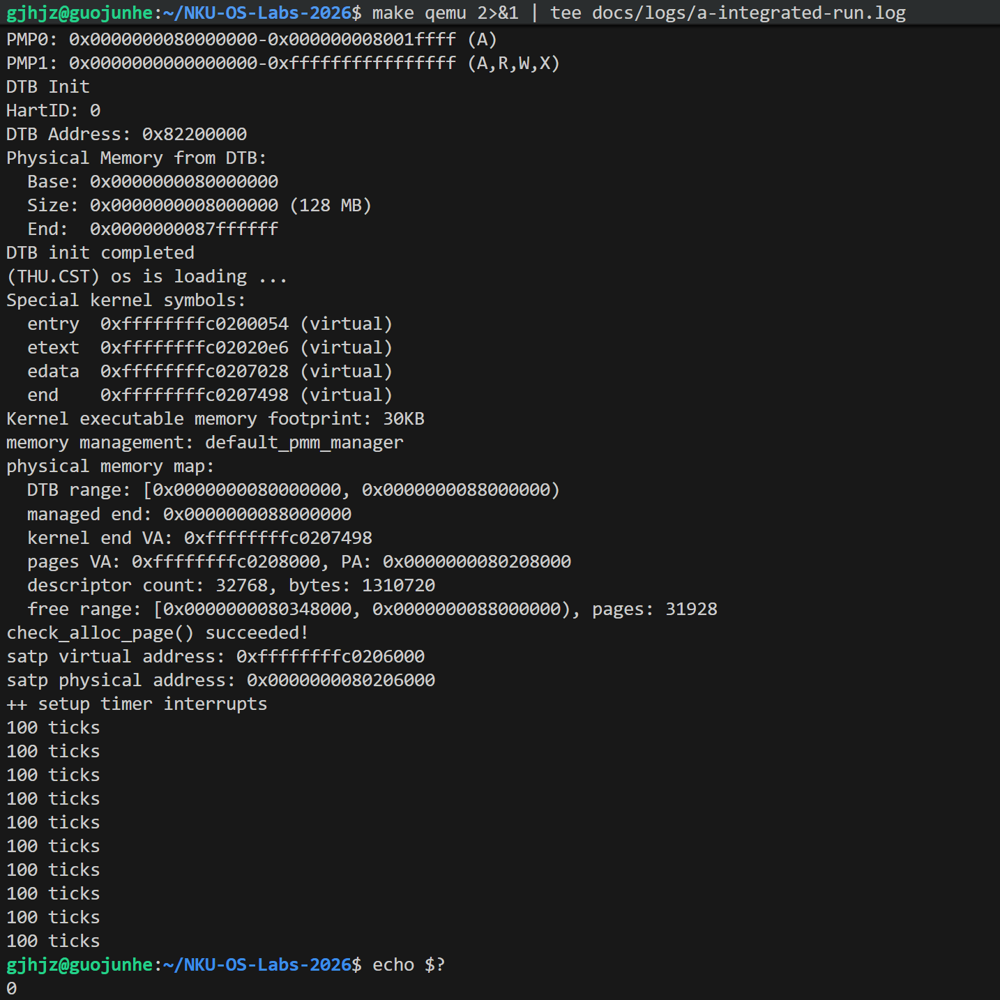
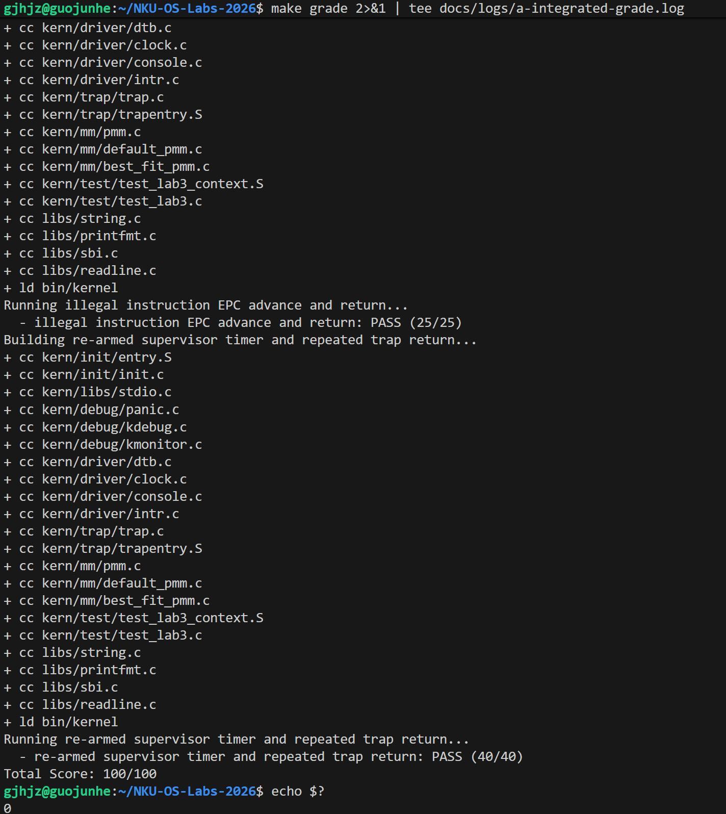
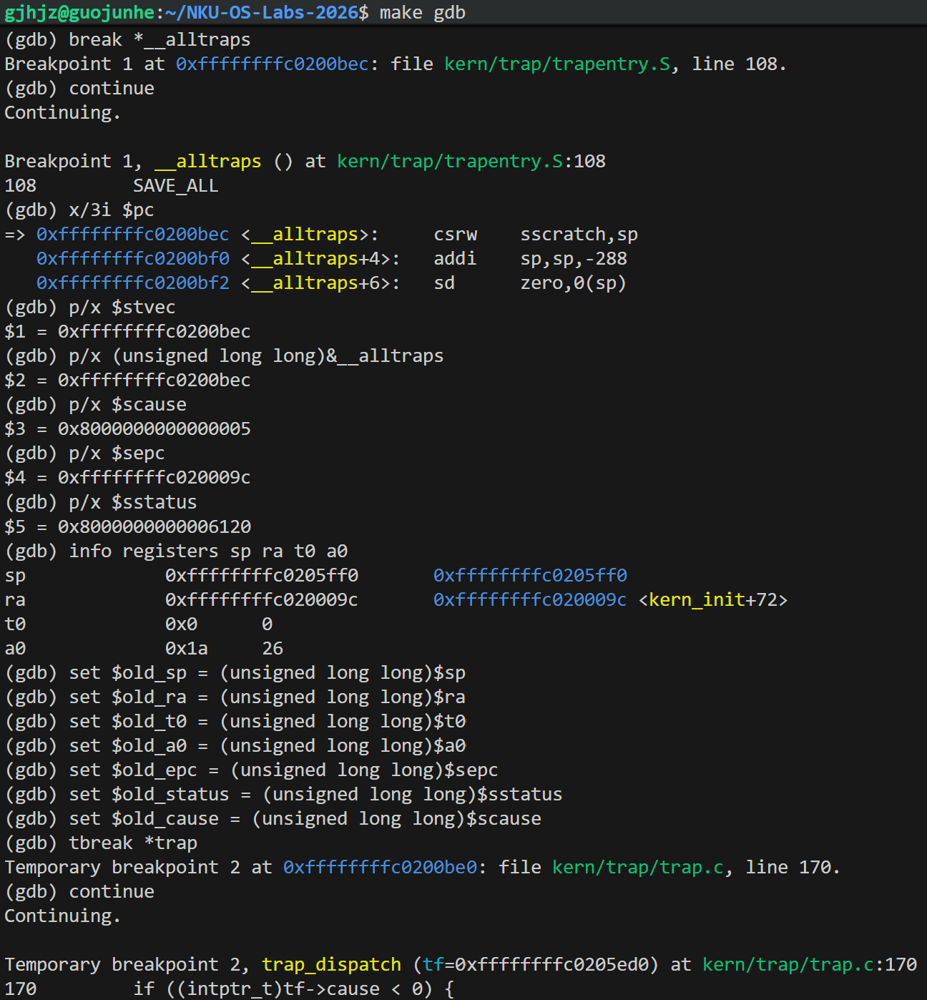

# Lab3 A：物理内存初始化迁移与 Trap 上下文保存恢复

负责人：国峻赫，学号 2412082  
协作：陈铭宇（B，处理函数）、尚文轩（C，测试与汇总）  
更新日期：2026-10-28  
当前状态：已完成局部编译、A 本机联合版本正常运行、教师评分 100/100，以及一次真实 S 模式时钟中断的 GDB 保存—处理—恢复—返回验证。

## 1. 工作范围与证据边界

本部分负责迁移 Lab2 的 `page_init()`，以及补全 `kern/trap/trapentry.S` 中的 `RESTORE_ALL` 和调用 C 处理函数的入口代码。保留教师提供的 `SAVE_ALL`、`struct trapframe` 布局、`trap()` 接口和 `sret` 返回路径。

本文区分源码设计分析、正常运行截图、教师评分结果和 GDB 现场证据。GDB 检查覆盖一次真实时钟中断及代表性寄存器，不能单凭这次检查宣称所有寄存器、所有异常类型及完整用户态切换均已验证。C 的独立验收状态另行记录。

## 2. 物理内存初始化迁移

### 2.1 迁移边界

仅将必要的 `page_init()` 放入 Lab3 `pmm.c` 指定位置，不用 Lab2 整个文件覆盖。Lab3 的 `alloc_pages()`、`free_pages()` 和 `nr_free_pages()` 已经包含中断状态保存与恢复，应完整保留。

这些包装在操作管理器时关闭本地中断，随后恢复调用前状态；不能无条件开启中断，也不能把它描述成完整的多核互斥机制。

当前保持教师默认的 `default_pmm_manager`，没有引入 Lab2 Buddy/SLUB 扩展。

### 2.2 初始化过程

1. 从 DTB 读取物理内存起点和长度，校验固定页编号基点及地址加法溢出。
2. 设置 `va_pa_offset`，计算框架可管理的物理范围。
3. 将管理末端限定在 DTB 范围和框架范围内，并向下按页对齐。
4. 用 `npage = PPN(managed_end)` 表示管理末端对应的页号；描述符数量为 `npage - nbase`。
5. 将 `pages` 数组放在内核 `end` 之后的页对齐位置；写数组前检查剩余空间能否容纳所有描述符。
6. 初始化描述符字段和链表节点，先标记为保留。
7. 跳过内核与描述符数组，将后续完整页通过 `init_memmap()` 登记为可分配范围。

因此，内核起始物理地址不等于空闲区起点。空闲区起点必须包含内核实际长度及描述符数组开销。

### 2.3 Lab3 常量适配

最初直接迁移时编译报错：

```text
error: 'PHYSICAL_MEMORY_END' undeclared
error: 'KERNEL_BEGIN_PADDR' undeclared
```

原因是旧函数依赖的两个宏在当前 Lab3 框架中未定义。保留原初始化逻辑，使用 Lab3 已有定义在函数内计算：

```c
va_pa_offset = PHYSICAL_MEMORY_OFFSET;

const uintptr_t kernel_begin_pa =
    (uintptr_t)KERNBASE - (uintptr_t)PHYSICAL_MEMORY_OFFSET;
const uintptr_t physical_memory_end =
    kernel_begin_pa + (uintptr_t)KMEMSIZE;
```

当前教师常量对应：

```text
KERNBASE               = 0xffffffffc0200000
PHYSICAL_MEMORY_OFFSET = 0xffffffff40000000
KMEMSIZE               = 0x07e00000
kernel_begin_pa       = 0x80200000
physical_memory_end   = 0x88000000（不包含）
```

这些边界由源码计算；本次正常运行也观察到管理末端为 0x88000000。实际管理范围仍受 DTB 限制，空闲页数按当前构建输出记录，详见第 8 节。

## 3. Trap 模块设计约束（spec）

- 使用教师原有保存流程，不修改 `SAVE_ALL` 和 TrapFrame 布局。
- 当前为 RV64，每个槽位 8 字节，共 36 个槽位。
- C 函数接口为 `void trap(struct trapframe *tf)`，第一个参数经 `a0` 传递。
- C 函数返回后，栈指针应重新指向同一个 TrapFrame。
- 恢复处理完成后的 `tf->epc`，允许 B 合法调整异常返回位置。
- 恢复所有需要保留的通用寄存器，最后恢复原始 `sp`。
- 通过 `sret` 返回，不将所有返回强制设为用户态，不额外无条件开中断。
- 不将异常处理策略写入汇编恢复代码；原因分类与 EPC 调整由 B 的处理函数负责。

## 4. TrapFrame 布局及保存过程

| 槽位 | C 结构含义 | RV64 字节偏移 |
|---|---|---:|
| 0～31 | `gpr` 中的 x0～x31；槽位 2 保存原始 sp | 0～248 |
| 32 | `status`，保存 sstatus | 256 |
| 33 | `epc`，保存 sepc | 264 |
| 34 | `badvaddr`，保存故障地址信息 | 272 |
| 35 | `cause`，保存 scause | 280 |

总长度为 `36 × 8 = 288` 字节。

Trap 硬件负责设置相关 CSR 和转移到入口，并不自动保存全部通用寄存器，也不自动为当前框架创建新的栈。教师 `SAVE_ALL` 先把原始 `sp` 写入 `sscratch`，再从当前栈分配 288 字节。

通用寄存器保存后，`csrrw s0, sscratch, x0` 取回原始栈指针并清零 `sscratch`，随后将原始 `sp` 和四个 CSR 值写入对应槽位。作为临时寄存器使用的 s0～s4，其原值在此前已保存。

若入口栈原本满足 16 字节对齐，则减去 288 字节后仍满足调用 C 函数的栈对齐要求。

## 5. 进入 C 处理函数

实现为：

```asm
__alltraps:
    SAVE_ALL

    #lab3 function1 2412082
    mv a0, sp
    jal trap
```

执行 `SAVE_ALL` 后，`sp` 指向 TrapFrame 首地址。`mv a0, sp` 按 RISC-V 调用约定传递第一个参数；`jal trap` 建立调用返回地址。

虽然 `jal` 改写了 `ra`，但被中断程序的原始 `ra` 已存入帧中。C 调用完成并恢复自身栈后，控制流顺序进入 `__trapret`，再恢复被中断程序的寄存器。

## 6. 上下文恢复设计

### 6.1 先恢复返回控制状态

```asm
LOAD t0, 32*REGBYTES(sp)
LOAD t1, 33*REGBYTES(sp)
csrw sstatus, t0
csrw sepc, t1
```

槽位 32、33 与教师保存布局一致。t0/t1 的原值保存在槽位 5、6，稍后会恢复，因此可以临时用于搬运 CSR。

`sepc` 使用处理完成后的帧值。对于需要跳过的断点或非法指令，B 应按实际指令长度更新 `tf->epc`；时钟中断通常不应主动推进 EPC。

保存的 cause 和故障地址用于诊断，不属于本实现必须写回的返回控制状态，因此不机械恢复所有 CSR 字段。

### 6.2 恢复通用寄存器，最后恢复 sp

实现依次加载 x1、x3～x31，最后执行：

```asm
LOAD x2, 2*REGBYTES(sp)
```

当前 `sp` 是访问帧的基址。如果提前恢复它，后续加载将读取错误的位置。最后这条指令用旧 sp 计算有效地址，再把读出的原始栈指针写入 x2。

x0 恒为零，不需要恢复。恢复原始 sp 后不再额外加 288，否则会重复释放栈空间。

### 6.3 使用 sret 返回

```asm
__trapret:
    RESTORE_ALL
    sret
```

普通 `ret` 依赖 ra；`sret` 按 sepc 和 sstatus 的返回控制字段恢复执行。正常 S 模式 Trap 进入时，硬件保存先前中断允许状态并清除 SIE；`sret` 按 SPIE、SPP 等字段完成相应状态转换。

当前基本实验主要验证内核 S 模式的 Trap，不能把所有 `sret` 描述成返回 U 模式。此实现也没有增加完整用户态栈切换或浮点上下文保存机制。

## 7. 早期局部编译与静态检查

最初分别编译 `pmm.o` 和 `trapentry.o`，用于区分模块编译问题与尚未集成的处理函数依赖。执行命令：

```bash
set -o pipefail
make obj/kern/mm/pmm.o obj/kern/trap/trapentry.o \
    2>&1 | tee docs/logs/a-module-build.log
echo $?
```

宏适配后的实际输出：

```text
+ cc kern/mm/pmm.c
make: 'obj/kern/trap/trapentry.o' is up to date.
0
```

汇编文件此前已单独编译成功，“is up to date”表示这次没有重复编译。局部编译成功后，通过差异核对 SAVE_ALL 未修改、恢复槽位与布局一致、sp 最后恢复、a0 传参和两处学号标记正确。该阶段仅证明目标文件可构建；后续运行与 GDB 证据单独列出。

## 8. A 本机联合版本运行与教师评分

### 8.1 版本与复现环境

本次在 A 的 WSL Ubuntu 20.04 环境、`~/NKU-OS-Labs-2026` 工程中进行，沿用课程 RISC-V 工具链及 QEMU 4.1.1 环境。共同分支为 `lab3`。

B 交接的实现提交为 `5c5461c6b71138c0af49e90c67e5fe7ecaf7bc64`，文档提交为 `7b6c636b487c6fc030b14ad246bc37be78c485c3`。

主要复现命令如下。先确保 PATH 中的 QEMU 与普通启动所用版本一致，评分脚本直接通过 PATH 调用 QEMU。

```bash
set -o pipefail
make clean
make 2>&1 | tee docs/logs/a-integrated-build.log
make qemu 2>&1 | tee docs/logs/a-integrated-run.log
echo $?
make grade 2>&1 | tee docs/logs/a-integrated-grade.log
echo $?
make 2>&1 | tee docs/logs/a-post-grade-build.log
```

评分后重新构建普通内核，再进行 GDB 检查；不能将评分注入的临时工程作为正式源码。

### 8.2 普通运行结果

本次正常运行截图显示：

| 项目 | 实测值 |
|---|---|
| 默认管理器 | `default_pmm_manager` |
| DTB 内存范围 | `[0x80000000, 0x88000000)`，128 MiB |
| 内核结束 VA | `0xffffffffc0207498` |
| 页描述符数组 VA / PA | `0xffffffffc0208000` / `0x80208000` |
| 页描述符数量 | 32768 |
| 页描述符总字节数 | 1310720 |
| 初始空闲范围 | `[0x80348000, 0x88000000)` |
| 初始空闲页数 | 31928 |
| 页表 VA / PA 打印值 | `0xffffffffc0206000` / `0x80206000` |
| PMM 自检 | `check_alloc_page() succeeded!` |
| 时钟输出 | 10 行 `100 ticks` |
| 运行结束 | 返回 shell；随后 `echo $?` 输出 0 |

页描述符数组占用 `1310720 / 4096 = 320` 页，从 `0x80208000` 开始，结束于 `0x80348000`，与打印的空闲区起点一致。

输出中的 `satp virtual address` / `satp physical address` 是框架对根页表地址的打印标签，不是直接读取出的整个 SATP CSR 数值。

当前 B 实现选择每 100 次时钟输出一次，累计 10 次输出后关机，即 1000 ticks。截图中的十行相同文字表示十个统计周期，不表示全局 ticks 一直为 100。该阈值属于当前实现选择，不写成教师明确规定。



### 8.3 教师评分结果

A 本机截图显示：

```text
illegal instruction EPC advance and return: PASS (25/25)
re-armed supervisor timer and repeated trap return: PASS (40/40)
Total Score: 100/100
```

随后 `echo $?` 为 0。截图未包含首项 35 分测试的完整显示，因此本文不补造该项终端原文；总分 100/100 为截图直接可见结果。完整分项过程应保留在本机评分日志中。

教师评分通过覆盖脚本中的 Trap 返回、异常和持续时钟检查，不代表所有补充测试、多核并发或完整用户态机制都已验证。



## 9. 一次真实时钟中断的 GDB 验证

本次使用 `make debug` 与 `make gdb` 两终端调试内核，没有使用宿主 GDB。以下地址均来自本次构建；重新编译后应重新查询符号和反汇编，不把地址硬编码为通用步骤。

### 9.1 Trap 入口与原因

在 `break *__alltraps` 命中时，第一条指令尚未执行：

```text
__alltraps = 0xffffffffc0200bec
stvec      = 0xffffffffc0200bec
scause     = 0x8000000000000005
sepc       = 0xffffffffc020009c
sstatus    = 0x8000000000006120
sp         = 0xffffffffc0205ff0
ra         = 0xffffffffc020009c
t0         = 0x0
a0         = 0x1a
```

`stvec` 与入口地址相同，低两位为 0，对应 Direct 模式。`scause` 最高位为 1，低位原因码为 5，说明本次是 S 模式时钟中断。

入口 `sstatus` 的 SPP 位为 1、SPIE 位为 1、SIE 位为 0，与从 S 模式进入、保存先前中断允许状态并关闭当前 S 中断的行为一致。这是入口状态解码，不是返回后 sstatus 的实测值。

反汇编开头为：

```asm
csrw sscratch, sp
addi sp, sp, -288
sd zero, 0(sp)
```

通过 GDB 便利变量保存原始 sp、ra、t0、a0、sepc、sstatus、scause，作为后续比较基准。



### 9.2 TrapFrame 地址、大小与内容

设置 `tbreak *trap` 后停在 `0xffffffffc0200be0`。GDB 的源代码显示为 `trap_dispatch(tf=...)`。这与编译器内联及调试行号映射相容，不能仅因显示名不同就认为调用了错误函数；若需要确定具体优化方式，可继续检查 `disassemble trap`。本次判断依据是实际断点地址、a0、sp 与保存帧内容。

```gdb
set $tf = (struct trapframe *)$a0
p sizeof(struct trapframe)
p/x $a0
p/x $sp
p ((unsigned long long)$a0 == (unsigned long long)$sp)
p ($old_sp - (unsigned long long)$tf)
```

实测：

```text
sizeof(struct trapframe) = 288
a0 = sp = tf = 0xffffffffc0205ed0
old_sp - tf = 288
```

地址差为 `0x120`，即 288 字节，与结构大小一致。

| 比较 | 结果 |
|---|---:|
| `tf->gpr.sp == old_sp` | 1 |
| `tf->gpr.ra == old_ra` | 1 |
| `tf->gpr.t0 == old_t0` | 1 |
| `tf->gpr.a0 == old_a0` | 1 |
| `tf->epc == old_epc` | 1 |
| `tf->status == old_status` | 1 |
| `tf->cause == old_cause` | 1 |

由此确认本次保存帧与入口状态一致，且 `a0` 正确指向该帧。本次手工比较的是上述代表性字段，不宣称已经逐一检查全部通用寄存器。


### 9.3 C 处理完成后的返回帧

在 `tbreak *__trapret` 命中时：

```text
__trapret = 0xffffffffc0200c54
sp == 原 TrapFrame 地址：1
return_pc = 0xffffffffc020009c
return_pc == old_epc：1
```

说明 C 函数返回后 sp 回到原帧地址；本次时钟处理没有改变返回 EPC。

### 9.4 恢复指令与 sret 前检查

反汇编中，起始两条为 `ld t0,256(sp)`、`ld t1,264(sp)`，随后写回 sstatus、sepc。末尾为：

```asm
0xffffffffc0200c9a: ld t6,248(sp)
0xffffffffc0200c9c: ld sp,16(sp)
0xffffffffc0200c9e: sret
```

在 `0xffffffffc0200c9e` 设置临时断点。到达时，RESTORE_ALL 已执行，sret 尚未执行：

| 项目 | 实测值 | 与返回帧比较 |
|---|---|---:|
| sepc | `0xffffffffc020009c` | 1 |
| sp | `0xffffffffc0205ff0` | 1 |
| ra | `0xffffffffc020009c` | 1 |
| t0 | `0x0` | 1 |
| a0 | `0x1a` | 1 |

这证明本次原始栈指针、返回 EPC 及所检查的通用寄存器已恢复。虽然反汇编包含 sstatus 写回，但本次没有在 sret 前后额外打印 sstatus，因此不把返回时各状态位数值列为实测结果。


### 9.5 单步 sret 后返回原执行位置

用户保存的本次终端输出继续记录：

```text
(gdb) si
kern_init () at kern/init/init.c:39
39          while (1)
(gdb) p/x $pc
$33 = 0xffffffffc020009c
(gdb) p/x $return_pc
$34 = 0xffffffffc020009c
(gdb) p ((unsigned long long)$pc == $return_pc)
$35 = 1
(gdb) x/i $pc
=> 0xffffffffc020009c <kern_init+72>: j 0xffffffffc020009c <kern_init+72>
```

因此本次已完成真实的“保存—C 处理—恢复—sret 返回”闭环。返回到 `while (1)` 是普通内核的预期行为，不是 Trap 返回失败。

随后 scause 仍为 `0x8000000000000005`、sepc 仍为 `0xffffffffc020009c`，不能据此判断又发生中断。sret 不负责清空这些寄存器；本次 PC 已指向 kern_init 的循环指令，而非 Trap 入口。

现有 `a-trap-return.png` 截图到 sret 前比较为止，单步返回后的证据来自本次提供的文本输出。原始 `a-trap-debug.log` 若包含该段，应一同提交；本次未上传该日志，因此不声称已经核对其完整内容。无需为了已有文本证据重复整个实验。

## 10. 材料索引与覆盖范围

本文按保存到 `docs/parts/a-trap-entry.md` 编写相对图片路径。

| 材料 | 证明内容 |
|---|---|
| `docs/images/a-integrated-run.png` | 内存布局、PMM 检查、10 次统计输出及返回 shell |
| `docs/images/a-integrated-grade.png` | 教师总分 100/100、可见分项及 shell 状态 0 |
| `docs/images/a-trap-entry_1.png` | 入口地址、CSR、入口寄存器及 C 停点 |
| `docs/images/a-trap-entry_2.png` | 288 字节帧、a0/sp 一致、保存值比较 |
| `docs/images/a-trap-return.png` | sret 前恢复值及比较 |

建议随本章节提交本机实际生成的 `a-integrated-commit.log`、构建/运行/评分日志、`a-post-grade-build.log`、`a-trap-debug.log`。本次审阅直接依据上传的五张截图和完整粘贴的 GDB 输出，未将没有上传的日志当作已逐行审阅材料。

本次 A 的 GDB 实测覆盖一次真实 S 模式时钟中断；教师评分提供其他规定场景的自动检查。B 的针对性自测结果应引用 B 的材料，C 的独立补充测试及最终共同回归应由 C 实际完成后记录，不能以 A 此次结果替代。

## 11. AI 辅助与人工核验

AI 辅助提供了迁移范围建议、TrapFrame 布局解释、恢复汇编草案、调试命令及错误分析。国峻赫完成了代码修改、差异检查、编译运行和 GDB 操作，保存并核对实际证据。

初版迁移建议遗漏 Lab3 的宏定义差异；实际编译指出两个宏未定义后，按当前已有常量计算对应物理地址范围，并重新编译通过。随后通过帧大小、保存值、返回帧与实际恢复寄存器之间的比较验证实现，而不是仅依据生成的代码或单次编译结果认定功能正确。

## 12. 阶段结论与提交前整理

A 已完成物理内存初始化迁移和 Trap 汇编实现；本机普通运行展示了 PMM 检查与持续时钟统计，教师评分达到 100/100。GDB 实测进一步验证了 288 字节 TrapFrame、C 参数传递、代表性寄存器保存恢复、时钟 EPC 保持不变及 sret 返回原位置。
