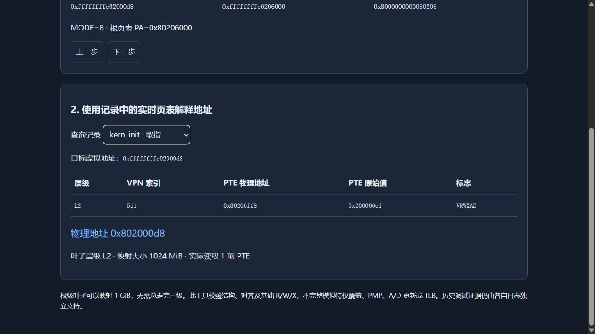

# 扩展：实时 GDB 地址查询和单步演示

负责人：尚文轩，2412456。对应课程文字记录 00:43:13 提到的可贡献课件的地址查询与单步演示建议；工具完成不等于老师已接受贡献或已给予加分，尚未向任何外部人员发送材料。

## 功能与真实执行边界

工具自动清理构建默认内核，从本次 ELF 反汇编定位 satp 写指令及其前一条指令，从本次符号读取 kern_entry、kern_init、bootstacktop 和根页表，不套用旧地址。启动自己的 QEMU GDB stub 随机空闲端口，并用现成 RISC-V GDB 完成：

1. 在 Bare 模式 satp 写指令的前一条指令处真实停止、单步，观察 PC 前进且 satp 仍为0。
2. 移除低地址断点，在高地址 kern_init 入口真实停止，读取 Sv39 satp、PC、SP，然后再次真实单步。
3. 读取本次 satp 指向的 PTE，解释 kern_init 取指和栈边界地址；演示未映射与非规范地址的拒绝。
4. 保存 JSON、完整 GDB/QEMU 日志、ELF SHA256、反汇编和可离线回放的页面。

自动会话正常结束或报错都会终止自己启动的 QEMU 进程组，不占用固定1234端口或结束别人的调试器。为了避开分页后低地址断点重插入问题，不在开启 satp 后保留低地址断点；真实单步在分页前后分别完成，不声称逐条单步跨过整个切换路径。

这是客体 GDB 的寄存器和页表读取，不是宿主 GDB 在 QEMU 内部的 MMU/TLB 断点。A 已有的宿主遍历、填充和直接命中记录仍是独立证据，不能合并为同一时间序列。结构化 walker 不完整模拟特权覆盖、PMP、MPRV/SUM/MXR、A/D 更新或 TLB。

## 本次实际结果

| 阶段 | PC | satp |
|---|---|---|
| Bare 单步前 | 0x80200030，or 指令 | 0 |
| Bare 单步后 | 0x80200034，即将写 satp | 0 |
| Sv39 高地址入口 | 0xffffffffc02000d8 | 0x8000000000080206 |
| 高地址单步后 | 0xffffffffc02000dc | 0x8000000000080206 |

这次默认构建根页表 PA 为 0x80206000，根索引511，PTE地址0x80206ff8，PTE为0x200000cf。根级叶子、权限VRWXAD，对应1GiB映射；kern_init VA 0xffffffffc02000d8 的完整物理地址为0x802000d8。只读取一项PTE，不声称总走完三级。

[真实 GDB 日志](../logs/address-demo/live-confirm/gdb.log)、[结构化数据](../logs/address-demo/live-confirm/trace.json)、[本次符号/源码摘要](../logs/address-demo/live-confirm/provenance.log)、[离线回放](../logs/address-demo/live-confirm/replay.html)。页面按钮和错误查询已通过实际浏览器操作验证，64位地址以十六进制字符串保存，避免 JavaScript Number 丢失精度。



## 复现与交互命令

```bash
source ~/OSopt/env.sh
python3 tools/test-sv39.py
python3 tools/demo-address-translation.py
```

每次保存到新的 `docs/logs/address-demo/<时间>/`。输出目录中 replay.html 可直接在浏览器打开，按钮只回放记录，不实时执行CPU。若希望在自己的调试会话实时查询：

```gdb
source tools/gdb_lab2.py
lab2-vtop &kern_init fetch
lab2-vtop &bootstacktop read
```

命令应在分页已开启、当前页表可通过启动高地址映射读取时使用。当前自动工具面向本实验的启动地址空间，不适用于任意进程页表或未知映射窗口。

## 验证、问题和规格迭代

`tools/test-sv39.py` 的17项手构页表 fixture 覆盖4KiB/2MiB/1GiB叶子、Bare、非规范地址、非法权限组合、未映射、错误大页对齐、保留位与读取失败：[离线测试](../logs/address-demo/live-confirm/decoder-tests.log)。这里是合成页表测试，和上述真实GDB运行分开表述。

首轮运行成功到达高地址入口，但GDB把satp按有符号64位返回，直接右移导致模式判断失败。修正为按uint64掩码解释寄存器后重跑通过，保留 [首轮失败日志](../logs/address-demo/live-first/gdb.log)。这不是页表或QEMU启动失败，也没有改动实际寄存器值。原始 [实施前四段式规格](../prompts/address-demo.md) 已在编码前保存，失败与修正是本次真实迭代。

## 面向课件贡献的交付说明

贡献候选包含源码、离线fixture、实时自动脚本、JSON、日志、回放及截图。任何机器只需已有相容的GCC/GDB/QEMU环境；没有接入外部大模型服务或密钥，工具为AI协作开发的确定性调试流程，不冒充自主推理模型服务。是否接收为课程课件由教师决定，贡献发送和署名核对由全组完成。
