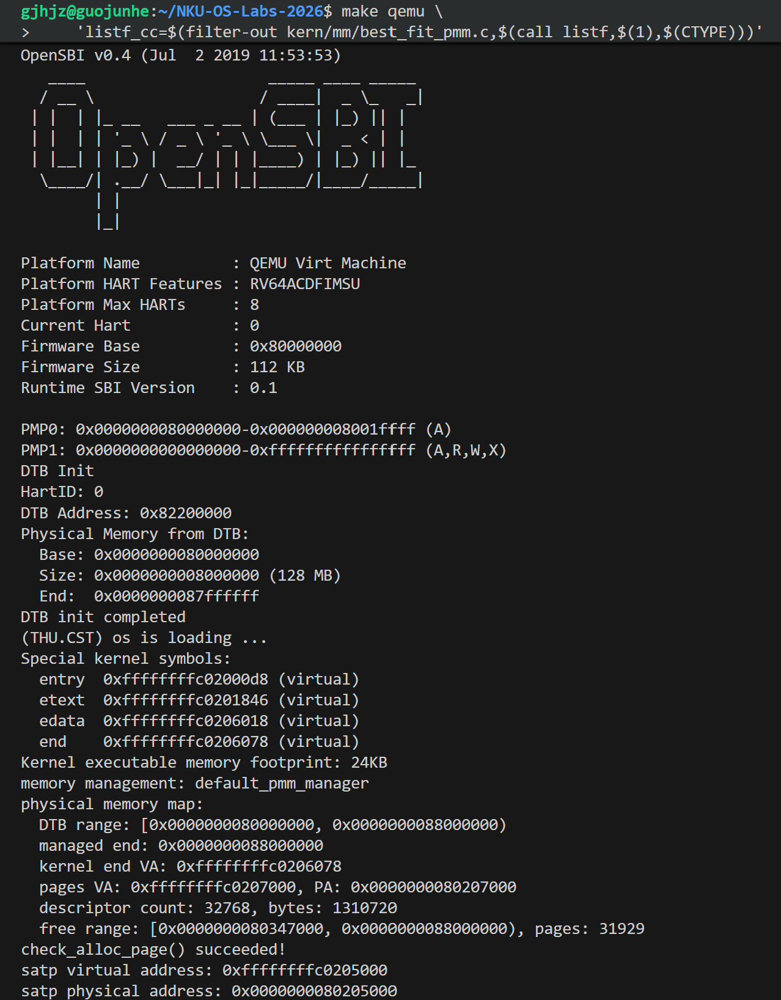

## 2. 物理内存初始化

### 2.1 初始化流程与页号语义

`kern_init()` 在清零 BSS 后调用 `dtb_init()`，再通过 `pmm_init()` 选择管理器、初始化描述符并执行自检。`page_init()` 从 `get_memory_base()` 和 `get_memory_size()` 取得设备树范围，将可管理末端限制在框架支持的 `0x88000000` 以内，并向下按页对齐。

`nbase` 表示 DRAM 起始物理页号，`npage` 表示物理页号上界；描述符数量为 `npage - nbase`。默认 128 MiB 内存对应 `nbase=0x80000`、`npage=0x88000`，共 32768 个 `Page`。本次结构体大小为 40 字节，数组占用 1310720 字节。

描述符数组从链接符号 `end` 之后的第一个页边界开始。全部描述符先标为保留，再将数组末端向上取整所得的完整可用区间交给管理器。固件、内核、描述符数组及对齐间隙因而不参与分配。`end` 由链接脚本定义，表示各段布局完成后的地址边界，并非运行时填入的普通变量。

输入基址异常、大小为零、地址溢出、内核或描述符空间不足时触发 `panic`；没有完整空闲页时不调用 `init_memmap()`。虚实转换使用前先设置 `va_pa_offset=0xffffffff40000000`。

### 2.2 内存布局验证

| 构建阶段 | 描述符起点 PA | 初始空闲区 | 空闲页数 | 根页表 PA |
|---|---|---|---|---|
| A 的 First-Fit 初始版本 | 0x80207000 | [0x80347000, 0x88000000) | 31929 | 0x80205000 |
| 主实验联合版本 | 0x80208000 | [0x80348000, 0x88000000) | 31928 | 0x80206000 |
| 启用 SLUB 的扩展版本 | 0x8020b000 | [0x8034b000, 0x88000000) | 31925 | 0x80208000 |

联合版本满足 `(0x88000000 - 0x80348000) / 4096 = 31928`。代码增加导致内核占用变化，表中各阶段分别对应独立构建。详细地址及摘要见 [A 初始化检查](../logs/a-page-init-debug.log)、[B 联合运行](../logs/b-integration-best-fit-run.log) 和 [扩展运行](../logs/extensions-runs/dtb-memory-matrix/slub-best-fit-run.log)。

### 2.3 动态范围与 FDT 解析

在教师 DTB 读取和 A 初始化的基础上，新增有界接口 `dtb_parse_memory(blob, length, &base, &size)`。解析器检查结构块、字符串块及属性边界，按字节读取大端整数，支持 1 或 2 个 address/size cell。截断、坏 magic、零长度、溢出和越界属性返回错误，输出保持不变。当前 PMM 管理一段连续内存，多个 bank 或更宽 cell 被显式拒绝。

宿主测试使用实际 C 解析器与独立 FDT，共通过 2230 项检查，包括全部截断点和 2000 次固定种子变异。两种管理器下的 QEMU 结果如下：

| QEMU 内存 | DTB 报告末端 | PMM 管理末端 |
|---|---|---|
| 64 MiB | 0x84000000 | 0x84000000 |
| 96 MiB | 0x86000000 | 0x86000000 |
| 128 MiB | 0x88000000 | 0x88000000 |
| 256 MiB | 0x90000000 | 0x88000000 |

256 MiB 配置验证了探测结果与管理上限的区分，并未扩展分配上限。见 [解析检查](../logs/dtb-parser-tests.log)、[64 MiB Buddy](../logs/extensions-runs/dtb-memory-matrix/slub-buddy-memory-64-run.log) 和 [256 MiB Best-Fit](../logs/extensions-runs/dtb-memory-matrix/slub-best-fit-memory-256-run.log)。
