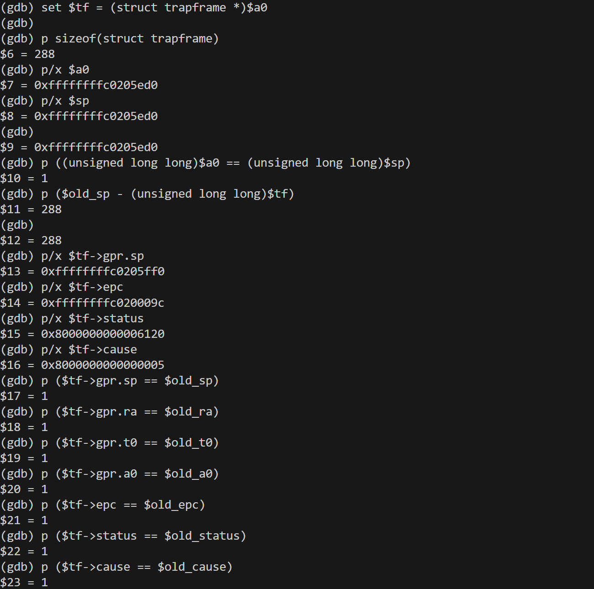
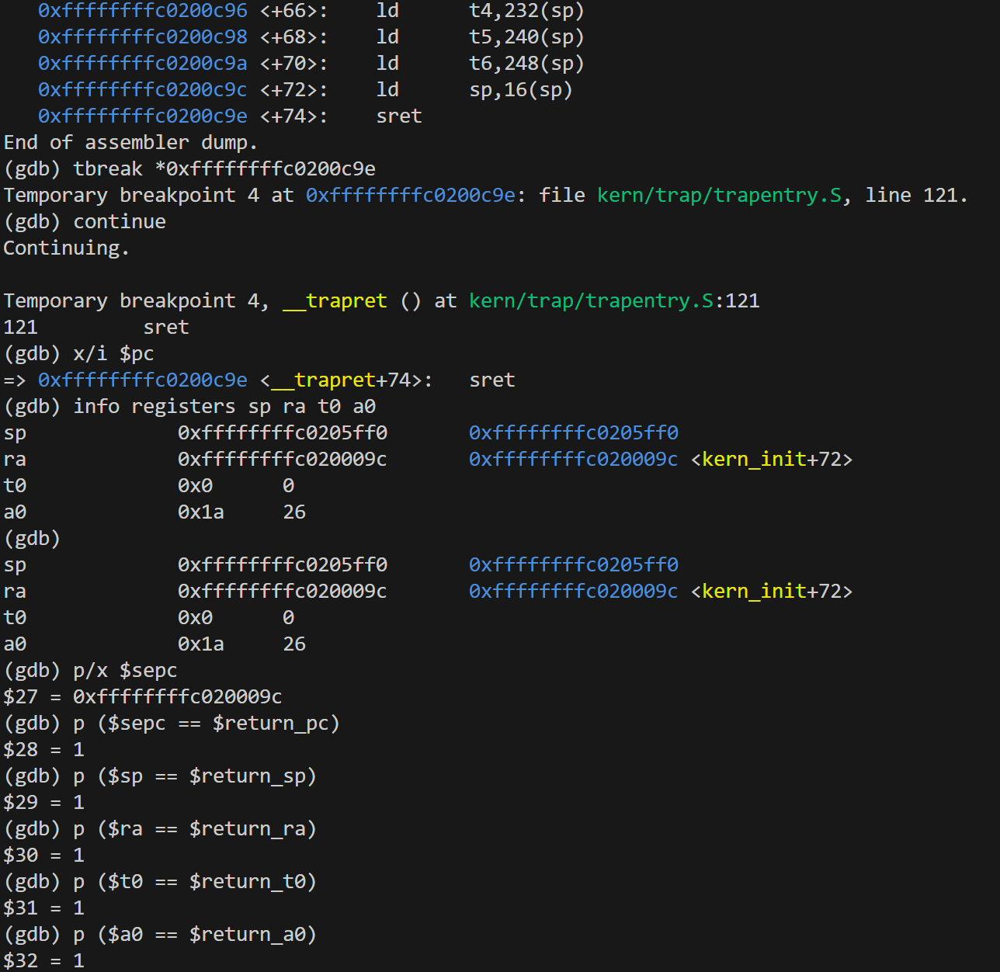

# Lab3：RISC-V 中断与异常处理

国峻赫（2412082）、陈铭宇（2412559）、尚文轩（2412456）

## 1. 实验目标与分工

本实验在物理内存管理基础上建立Trap的保存、分发、处理与返回路径，验证异常后的继续执行及持续时钟中断。A负责初始化迁移和Trap汇编，B负责Best-Fit必要迁移及中断异常处理，C负责独立补充测试、联合验收与报告整合。默认保持First-Fit，不迁入Lab2的Buddy或SLUB。

被测核心代码由A/B完成，C测试基于 `f475900` 的内核；C测试及证据提交为 `2aeec0f`，源码哈希见 [验收清单](docs/logs/c-runs/20261029-034244/manifest.log)。文档提交不会改变被测内核。各环境地址与页数以对应构建为准。

## 2. Trap完整路径

```text
硬件设置sepc/scause/stval及sstatus，跳至stvec
  → __alltraps → SAVE_ALL → a0=sp → trap(tf)
  → trap_dispatch → interrupt_handler / exception_handler
  → __trapret → RESTORE_ALL → sret → 恢复执行
```

RISC-V硬件不替软件把全部通用寄存器压栈。硬件记录返回位置、原因和状态，汇编入口再建立内存中的TrapFrame。当前stvec采用统一入口，原因分发由C函数完成。

同步异常与当前指令相关；中断来自异步事件。处理器保存的sepc是返回依据，不能对所有Trap无条件加4：本实验可跳过的断点和非法指令按长度推进，时钟分支保持EPC。真实页故障通常需要修复后重试，不属于当前跳过策略。

## 3. 初始化与上下文保存恢复

### 3.1 物理内存迁移

page_init从DTB获得范围，检查边界，将Page数组放在内核末端后的对齐区域，先保留全部页，再登记元数据末端之后的完整空闲页。npage是页号上界，描述符数量为npage-nbase。联合基础构建128MiB对应32768个描述符，每个40字节，数组共1310720字节，空闲31928页。

保留Lab3已有PMM中断保护包装。local_intr_save记录原SIE，操作管理器期间关闭本地中断，恢复时仅在原先开启的情况下重新开启；它不提供多核互斥。

### 3.2 TrapFrame布局与返回

教师SAVE_ALL保存32个通用寄存器槽位及status、epc、badvaddr、cause，共36×8=288字节，保持16字节栈对齐。原sp经sscratch暂存后写入第2槽；a0传递当前帧地址，C可以修改帧中的返回EPC。

RESTORE_ALL先取返回用sstatus和sepc，再恢复通用寄存器，最后加载原sp，避免提前失去帧基址。cause和badvaddr作为诊断快照，不机械写回。sret根据SPP恢复特权级，并按SPIE恢复SIE；当前实验从S模式进入并返回S模式，不是每次返回用户态。普通ret不能替代sret完成这些控制状态变化。

### 3.3 GDB证据

A在实际版本 `7b6c636` 上观察真实S时钟Trap：stvec与__alltraps均为0xffffffffc0200bec，scause为0x8000000000000005，a0=sp=tf=0xffffffffc0205ed0，原sp=0xffffffffc0205ff0，差值288。保存和恢复的sp、ra、t0、a0及返回CSR比较符合预期；时钟不改变EPC，sret后PC为0xffffffffc020009c。

该观察覆盖一次真实时钟及代表性寄存器，不声称手工穷举全部上下文。详见 [A章节](docs/parts/a-trap-entry.md)、[被测提交](docs/logs/a-integrated-commit.log)、[GDB日志](docs/logs/a-trap-debug.log)。





## 4. 中断与异常处理

interrupt_handler先去除cause最高位中断标志，再按原因分类。S时钟分支重设下一次事件、ticks递增一次，每100次输出100 ticks。当前SHUTDOWN_AFTER为10次统计，即1000 ticks后调用SBI关机；这是小组实现选择，现有材料没有规定具体阈值。每行100 ticks是区间统计，不表示ticks总值一直为100。

exception_handler对非法指令和断点输出原因及地址，再读取故障指令低16位：低两位不为11时推进2，否则对本实验32位编码推进4。该策略限定于可读取的16/32位测试指令，不是任意长指令解码器。未覆盖异常打印帧并返回诊断；未知中断同样打印原因与帧，不读取无效EPC。

Best-Fit只迁移必要状态及操作，保留教师检查，.check使用best_fit_check，避免引入Lab2独立测试依赖。默认仍First-Fit，Best-Fit在临时副本单独运行。完整设计见 [B章节](docs/parts/b-trap-handlers.md)。

## 5. 独立测试与联合结果

### 5.1 方法

C在临时工程加入独立C/汇编探针，正式init.c、Makefile和教师测试不改动。四种显式编码各重复16次，检查异常后立即执行的标记及32个通用寄存器槽位。gp/tp保留原值；sp、ra、a0保留调用语义；探针恢复调用者s寄存器，避免测试自身违反ABI。

中断保护分别验证原SIE开、关状态下的成功分配、失败申请、释放和嵌套保护。clock_init后另行等待真实ticks超过201，随后继续运行到1000 ticks关机，要求十次统计、无panic、退出0。详细判据见 [C章节](docs/parts/c-validation.md)。

### 5.2 结果

| 验证 | 结果 | 证据 |
|---|---|---|
| A真实时钟GDB | 帧参数、代表性寄存器、EPC与返回符合预期 | [调试](docs/logs/a-trap-debug.log) |
| A/B原环境评分 | 100/100 | [A](docs/logs/a-integrated-grade.log)、[B](docs/logs/b-grade.log) |
| C First-Fit补充测试 | 64次异常、快照、SIE及持续时钟关机通过 | [运行](docs/logs/c-runs/20261029-034244/default-run.log) |
| C Best-Fit补充测试 | 相同判据通过 | [运行](docs/logs/c-runs/20261029-034244/best_fit-run.log) |
| C教师评分 | 入口35、非法指令25、时钟40，总100/100 | [评分](docs/logs/c-grade.log) |

C使用Ubuntu22.04、GCC10.2、QEMU6.2、OpenSBI1.3；A/B使用QEMU4.1.1及OpenSBI0.4。C评分通过临时PATH适配semihosting控制台输出，不修改教师逻辑或本机OSopt包装器。跨环境结论分别由各自日志支持，不将队友结果冒充本机执行。

### 5.3 定位与修正

C首次测试目录位于链接顺序开头，导致原始镜像入口不是kern_entry，OpenSBI后不能启动。将测试目录移至kern/init之后解决，原始失败日志保留。随后内核运行成功但运行器没有规范化CRLF，造成统计断言误报；修正判据读取，保留原始字节日志，重新独立运行两配置通过。这些都是测试接入问题，没有修改A/B实现来迁就测试。

### 5.4 用户态与权限保护扩展

2026-10-30补充独立用户态实验，正式默认入口保持不变。扩展页表保留原高地址S态映射，低地址0x1000映射用户代码（U/R/X，禁止写），0x2000映射用户栈（U/R/W，无执行权限），栈顶0x3000。用户代码和栈分别占独立对齐页，不把整个内核大页设置为U可访问。

S态通过sret进入U态。扩展向量用sscratch交换到保存的内核栈，建立同布局288字节帧，调用专用处理器；恢复后再次sret返回U。第一次ecall返回a0=0x567，U代码实际读写栈，并尝试读取sstatus、读取内核起点、写入用户代码页。处理器依次检查异常原因2、13、15及对应访存地址，跳过三条明确为32位的测试指令。第二次ecall检查返回值、栈内容和全部负例计数，再设置SPP及返回位置，回到原S态调用点。

扩展结束恢复satp、stvec、sscratch、sie、sstatus，并刷新地址转换缓存。两种PMM均通过上述断言，并继续通过原异常、SIE和1000 ticks关机回归。见 [First-Fit](docs/logs/c-runs/20261030-093858/default-run.log)、[Best-Fit](docs/logs/c-runs/20261030-093858/best_fit-run.log)、[源码清单](docs/logs/c-runs/20261030-093858/manifest.log) 与 [扩展规格](docs/prompts/c-user-challenge.md)。

该实验是受控U源同步Trap：期间关闭中断，不处理S源或嵌套Trap；不是完整用户进程或通用系统调用子系统。栈NX已通过PTE设置，本轮没有执行栈取指负例。异常跳过仅适用于这三条已知指令，不代表修复页故障。完整实验手册尚未取得，不能据当前用户态扩展推定所有Challenge已覆盖。

## 6. AI辅助过程与讨论

各模块以职责、依赖、交付接口和可验证行为整理规格，记录实现建议、实际反馈和修正。A/B本人记录见 [A](docs/prompts/a-trap-entry.md)、[B](docs/prompts/b-trap-handlers.md)，C编码前规格及迭代见 [C](docs/prompts/c-validation.md)。这些文档包含会话整理，不冒充完整逐字聊天导出。

实验体现了机制与策略的区分：汇编负责上下文机制，C处理函数决定分支行为；同一TrapFrame连接保存、处理和恢复。SIE保护解决单核临界区被中断重入的问题，不代替多核锁。sret必须使用处理后的EPC和保存的特权状态，不能一律退到U模式。

100/100覆盖教师三项评分，不能代替正常关机、全部异常或用户态切换证明。用户态切换由新增独立实验支持，尚未实现完整嵌套Trap、页故障修复和任意长非法指令恢复。全组仍需通读、对照完整手册并按课程入口正式提交。

## 7. 复现

仓库根目录，各新shell激活本机环境：

```bash
source ~/OSopt/env.sh
make clean
make
make qemu
python3 tools/c-regression.py
python3 tools/c-grade.py       # C环境；A/B原环境为make grade
make                          # 恢复默认镜像
python3 tools/assemble-lab3-report.py --check
```

调试使用make debug与make gdb两个终端，以当前构建符号定位__alltraps、trap和__trapret，不硬编码历史断点地址。真实源码与日志入口分别见A/B/C个人章节。
