# 操作系统 Lab2：物理内存管理与地址翻译

汇总日期：2026-10-20。成员：国峻赫（A，学号待本人确认）、陈铭宇（B，2412559）、尚文轩（C，2412456）。

## 范围、分工与版本说明

实验包含物理页初始化、First-Fit 分析、Best-Fit、Buddy、QEMU 双重 GDB 和报告材料。A 负责初始化与地址翻译；B 负责 First/Best-Fit 及基础测试；C 负责 Buddy、测试和本文汇总。教师框架、教师检查、组员实现与 AI 辅助范围见各章，不将教师代码记为本组从零实现。

C 的 Buddy 成果已提交为 b5c05e9，并包含在远程 lab2。A 的 cc646e0 完成联合回归，6baf620 补足分页切换和软件 TLB 直接命中；B 的 c3c4dd9、cf881a9 完成独立联合验证和交接。本次汇总以已同步的 cf881a9 及其后的本地文档提交为基础，源码及运行证据按各日志记录的 HEAD、SHA256 关联。

| 验证阶段 | 环境 | 实际结果 |
|---|---|---|
| C 初次实现 | Ubuntu 22.04 / GCC 10.2.0 / QEMU 6.2.0 / OpenSBI 1.3 | Buddy 六组自检、1024 次混合操作和 Best-Fit 行为通过，恢复 31928 页；本机控制台转接后评分 20/20 |
| A 联合回归 | Ubuntu 20.04 / GCC 10.2.0 / QEMU 4.1.1 / OpenSBI 0.4 | Buddy、Best-Fit 通过，普通 make grade 为 20/20；分页前后对照和后续取指查询直接命中 TLB 已补录 |
| B 独立联合验收 | Ubuntu 24.04.5 / GCC 10.2.0 / QEMU 4.1.1 / OpenSBI 0.4 | 已复核 Buddy 契约，切换后两种模式通过，普通 make grade 为 20/20，最后恢复默认构建 |

教师 20/20 只覆盖 Page Init 和 Best-Fit；Buddy 由独立自检支持，地址翻译由 A 调试记录支持。A 的直接命中记录证明后续取指地址查询跳过 tlb_fill()，不能表述为“CPU 第二次执行 kern_init”。C 本轮核对并汇总这些已交付证据，没有声称在本机重新完成 A 的调试。

各章保留历史版本和证据限定：First-Fit 旧版为 31929 页、根页表 PA 0x80205000；联合版为 31928 页、根页表 PA 0x80206000。不同构建地址不能混用。a-build.log、a-qemu-pagewalk-retry.log、a-qemu-pagewalk.log、a-ucore-pagewalk.log 均为本地历史记录，未随本次提交交付，不提供下载链接；成功页表遍历引用已交付的 a-qemu-pagewalk-body.log。

剩余人工核对：A 的 page_init() 学号标记仍为 YOUR CODE，初始化实际 AI 交互记录仍有占位内容，需要本人确认和补齐；全组三人通读及最终提交版本签认尚待进行。Challenge SLUB 未实现，多核等未测边界见各章。这些真实限制不因更新进度文字而删除。

个人章节是维护源，使用 `python3 tools/assemble-lab2-report.py` 重新汇总，或加 `--check` 只核对一致性。当前源码在仓库根目录，与计划中的 labcodes/lab2 目录不同。C 本次按子任务在本地 commit，push 由用户执行；这不改变 Buddy 成果已在远程的事实。各章中的初次开发、失败日志和带日期的交接过程按当时状态理解。

## 快速复现与材料入口

```bash
# 先按各自环境激活工具链；C 本机执行 source ~/OSopt/env.sh
# 手动启动 Buddy：
make clean
make DEFS=-DPMM_BUDDY
make qemu DEFS=-DPMM_BUDDY
# 退出 QEMU 后切回默认：
make clean
make
make qemu
# 再退出 QEMU 后，A/B 环境普通评分：
make grade
# C 本机 QEMU 6.2.0 / OpenSBI 1.3 使用：
make grade QEMU='python3 tools/qemu-grade-console.py'
```

切换编译宏必须 clean 后重建并重启。两条评分命令按环境选择其一。A 旧章节的临时排除 best_fit_pmm.c 命令仅作历史记录，不适用于当前集成版本。本机已有 QEMU 包装器保持原样。

- [A 个人原稿](docs/parts/a-memory-debug.md)
- [B 算法原稿](docs/parts/b-first-best-fit.md)、[B 测试原稿](docs/parts/b-best-fit-tests.md)
- [C 个人原稿](docs/parts/c-buddy.md)、[C 交接清单](docs/notes/c-progress.md)
- [C 实现规格与提示词](docs/prompts/c-buddy.md)、[C 测试规格与提示词](docs/prompts/c-buddy-tests.md)
- [C Buddy 验证](docs/logs/c-buddy-run.log)、[C 默认回归](docs/logs/c-best-fit-run.log)、[C 教师评分](docs/logs/c-grade.log)
- [A 联合回归](docs/logs/a-after-c-grade.log)、[A 分页切换补录](docs/logs/a-paging-transition-confirm.log)、[A TLB 直接命中](docs/logs/a-qemu-tlb-hit-after-c.log)
- [B 联合环境与摘要](docs/logs/b-integration-environment.log)、[B Buddy](docs/logs/b-integration-buddy-run.log)、[B Best-Fit](docs/logs/b-integration-best-fit-run.log)、[B 普通评分](docs/logs/b-integration-grade.log)

以下为各成员章节。所有“本次”“当前”等叙述依各章说明的日期和基线理解；历史待办不覆盖上文的本轮验证结论。

## A：物理内存初始化与调试记录

> 负责人：国峻赫<br>
> 更新日期：2026-10-19。<br>
> 当前阶段：已完成初始化、旧版页表遍历与 TLB 填充、联合版本 Buddy/Best-Fit 回归、分页切换前后对照，以及软件 TLB 直接命中观察；待完成报告与附件的最终核对。<br>
> 仓库分支：lab2。当前源码和 Makefile 位于仓库根目录。<br>
> 本文保存位置：docs/parts/a-memory-debug.md。

### 1. 工作范围与当前状态

本部分负责实现 `kern/mm/pmm.c` 中的 `page_init()`，从设备树解析结果建立物理页描述符，并将可用物理页交给当前分配器。同时分析启动页表，并通过宿主 GDB 和 RISC-V GDB 调试 QEMU 中的地址翻译与 TLB 行为。

实验分两个阶段，证据分别保留：

1. **First-Fit 历史阶段（第 3～12 节）**：完成 `page_init()`、初始化检查和宿主/客体双重 GDB 的页表遍历、软件 TLB 填充及填充后复核。该阶段临时排除尚未完成的 Best-Fit 源文件。
2. **联合版本阶段（第 16～18 节）**：获取陈铭宇（B）的 Best-Fit 和尚文轩（C）的 Buddy 后，在 A 本机完成两种管理器回归及教师评分，并补录分页配置前后状态与取指地址查询直接命中软件 TLB 的现场。

| 版本记录 | 用途 |
|---|---|
| `79b5791a358d2e5f684b09e09dbd201325577c59` | A 初始化源码基线；历史 First-Fit 及页表遍历证据对应这一阶段 |
| `8612090` | A 第一批页表调试文档与证据提交 |
| `a3574e2` | 合并 A、B 成果的提交 |
| `b5c05e9` | C 的 Buddy 实现提交，本轮联合回归以获取该提交后的源码为基础 |

后续日志、截图的提交与源码提交分开记录；本人已提交回归及启动反汇编材料，具体提交号以仓库历史为准，不在本文编造未知提交号。联合回归时记录的完整 HEAD 见 `docs/logs/a-after-c-revision.log`。

第 3～12 节中的“本次”指历史阶段；第 16～18 节中的“本次”指 2026-10-19 的联合版本实验。不同构建地址不能混用；本次记录不表示所有证据来自同一次 QEMU 会话。

### 2. 实验环境与证据

| 项目 | 本次环境 |
|---|---|
| 操作系统 | WSL Ubuntu 20.04 |
| 仓库目录 | `~/NKU-OS-Labs-2026` |
| 交叉编译工具链 | SiFive GCC-Metal 10.2.0 |
| 客体调试器 | SiFive GDB-Metal 10.1 |
| 模拟器 | QEMU 4.1.1 |
| 固件 | OpenSBI v0.4 |
| QEMU 默认内存 | 128 MiB |
| 历史阶段管理器 | `default_pmm_manager`，即 First Fit |
| 联合版本默认管理器 | `best_fit_pmm_manager` |
| 联合版本 Buddy 模式 | `buddy_pmm_manager`，使用 `DEFS=-DPMM_BUDDY` 构建 |

早期初始化阶段的材料如下；文件存在性和具体内容应在最终提交前核对：

- [环境记录](docs/logs/a-environment.log)
- 初次构建失败记录：`docs/logs/a-build.log`，属于本地历史记录，未随本次提交交付，不作为已交付附件或成功构建证据。
- [临时 First Fit 构建记录](docs/logs/a-build-first-fit.log)
- [初始化 GDB 日志](docs/logs/a-page-init-debug.log)
- [规格与 AI 交互记录](docs/prompts/a-page-init.md)

### 3. 初始化的整体流程

`kern_init()` 先清零 BSS，再调用 `dtb_init()`，读取并保存设备树中的内存信息，随后调用 `pmm_init()`。

`pmm_init()` 依次执行：

1. `init_pmm_manager()`：选择分配器，调用其初始化接口，建立空的内部管理状态。
2. `page_init()`：读取内存范围，建立页描述符，排除已占用区域，并通过 `init_memmap()` 登记空闲页。
3. `check_alloc_page()`：调用当前管理器的检查函数。
4. 获取并输出启动页表的虚拟地址和物理地址。

`pmm_init()` 返回后，`kern_init()` 进入 `while (1)`。因此输出停止且终端不返回 shell，是框架预定的运行行为。

框架在进入 `kern_init()` 之前已经配置启动页表并启用 Sv39。`page_init()` 的职责是在这一地址映射基础上组织物理页，不是创建完整的按需分页系统。

### 4. page_init() 的功能规格

目标函数为 `static void page_init(void)`，不接收参数，也不返回数值。

输入来源：

- `get_memory_base()` 和 `get_memory_size()`：设备树解析结果。
- 链接符号 `end`：内核镜像末端虚拟地址。
- `PGSIZE`、`DRAM_BASE`、`PHYSICAL_MEMORY_END`、`PHYSICAL_MEMORY_OFFSET` 等框架常量。

输出状态：

- `va_pa_offset`：内核直接映射的虚实地址偏移。
- `npage`：管理范围的物理页号上界。
- `pages`：物理页描述符数组的虚拟地址。
- 当前分配器中登记的初始空闲页区间。

主要约束：

1. 区分虚拟地址、物理地址、物理页号和 `Page` 指针。
2. 校验内存范围和加法溢出，并遵守框架的管理上限。
3. 描述符数组位于内核之后，起点按页对齐。
4. 写描述符前检查数组空间是否足够。
5. 先将描述符设置为保留，随后只将确认可用的完整页面交给分配器。
6. OpenSBI、内核、描述符数组及对齐空隙不能作为空闲页分配。
7. 没有完整空闲页时不调用 `init_memmap()`；这不意味着后续需要分配页面的自检仍能通过。

### 5. 实现思路与关键概念

#### 5.1 读取内存信息并确定边界

实现从 DTB 获取起点与大小，计算报告的末端，再结合 `PHYSICAL_MEMORY_END` 确定实际管理末端，并向下按页对齐。

当前框架的描述符编号以固定 `DRAM_BASE` 为起点，因此实现检查 DTB 起点是否符合该约定。该实现面向当前实验框架，没有声称支持任意起点或多个不连续内存区。

本次默认配置中，DTB 末端和框架管理上限均为 `0x88000000`。如果后续改变 QEMU 内存大小，需要重新核对管理上限和教师测试对 `npage` 的假设。

#### 5.2 物理地址、虚拟地址与页号

在本实验的直接映射区域内，地址转换使用偏移：

```text
va_pa_offset = 0xffffffff40000000
物理地址 = 虚拟地址 - va_pa_offset
```

这里的运算按框架使用的 64 位地址表示进行。使用 `PADDR()` 前应先正确设置偏移。

`nbase` 是 DRAM 起始物理页号，`npage` 是末端物理页号上界，描述符数量为 `npage - nbase`。`pages[i]` 描述的物理页号为 `nbase + i`。

`pages` 是描述符数组地址，并不是所描述的物理页数据地址；描述符数组自身也占用需要保留的物理内存。

#### 5.3 放置描述符数组

首先对内核末端 `end` 向上按页对齐，作为数组的虚拟起点。数组所需空间为：

```text
(npage - nbase) * sizeof(struct Page)
```

在写入数组前检查其物理范围没有超过管理末端。随后初始化每个描述符的引用计数、状态、块大小和链表字段，并设置保留标记。

#### 5.4 登记空闲页

描述符数组末端向上按页对齐后，得到空闲物理页起点。该起点到管理末端之间的完整页面通过：

```c
init_memmap(pa2page(free_begin), free_count);
```

交给当前分配器。`init_memmap()` 继续调用管理器的具体实现，建立空闲链表和计数。因此初始化部分负责划定可用区域，分配器负责组织和分配这些区域。

### 6. 初次构建问题及处理

初次普通 `make` 在 `best_fit_pmm.c` 中失败：

```text
error: 'free_list' undeclared
error: 'nr_free' undeclared
```

原始文件保留了 Best Fit 检查函数，但分配器内部状态和管理函数尚未实现。检查函数引用上述状态，而 Makefile 默认会编译该文件，所以即使 `pmm.c` 已编译通过，整套工程仍无法完成构建。

本阶段没有删除或修改检查函数，而是保留 First Fit 为当前管理器，通过 Make 命令行临时排除未完成的 Best Fit 源文件：

```bash
set -o pipefail
make clean
make 'listf_cc=$(filter-out kern/mm/best_fit_pmm.c,$(call listf,$(1),$(CTYPE)))' \
    2>&1 | tee docs/logs/a-build-first-fit.log

make qemu \
    'listf_cc=$(filter-out kern/mm/best_fit_pmm.c,$(call listf,$(1),$(CTYPE)))'
```

该覆盖只影响相应的 Make 调用，不修改公共 Makefile。**这是历史复现命令，不适用于当前联合版本。**Best-Fit 完成后的普通构建及联合验证已完成，见第 16 节。

这一问题属于未完成模块造成的集成阻塞，不是已经定位到的 `page_init()` 运行错误，也不应写成 AI 生成初始化代码的 Bug。

### 7. 运行结果与布局核对

本次实际输出的关键部分如下：

```text
DTB Init
HartID: 0
DTB Address: 0x82200000
Physical Memory from DTB:
  Base: 0x0000000080000000
  Size: 0x0000000008000000 (128 MB)
  End:  0x0000000087ffffff
DTB init completed

Special kernel symbols:
  entry  0xffffffffc02000d8 (virtual)
  etext  0xffffffffc0201846 (virtual)
  edata  0xffffffffc0206018 (virtual)
  end    0xffffffffc0206078 (virtual)
Kernel executable memory footprint: 24KB
memory management: default_pmm_manager
physical memory map:
  DTB range: [0x0000000080000000, 0x0000000088000000)
  managed end: 0x0000000088000000
  kernel end VA: 0xffffffffc0206078
  pages VA: 0xffffffffc0207000, PA: 0x0000000080207000
  descriptor count: 32768, bytes: 1310720
  free range: [0x0000000080347000, 0x0000000088000000), pages: 31929
check_alloc_page() succeeded!
satp virtual address: 0xffffffffc0205000
satp physical address: 0x0000000080205000
```

上述 `entry` 是框架打印的 `kern_init` 地址，不能直接当作汇编符号 `kern_entry` 的地址。最后两行打印的是启动页表的虚拟、物理地址，不是读取 `satp` CSR 得到的寄存器原始值。


图中展示 DTB 内存范围、当前管理器、描述符布局、空闲区及分配器检查结果。

| 项目 | 本次结果 | 核对方法 |
|---|---|---|
| DRAM 范围 | `[0x80000000, 0x88000000)` | 长度为 `0x08000000`，即 128 MiB |
| nbase | `0x80000` | `0x80000000 / 4096` |
| npage | `0x88000` | `0x88000000 / 4096` |
| 描述符数量 | 32768 | `0x88000 - 0x80000` |
| 内核结束物理地址 | `0x80206078` | `end` 减去映射偏移 |
| 描述符起点 | `0x80207000` | 内核末端向上按 4 KiB 对齐 |
| 描述符总大小 | 1310720 字节，即 `0x140000` | 32768 × 40 字节 |
| 空闲起点 | `0x80347000` | `0x80207000 + 0x140000`，本次已对齐 |
| 初始空闲页数 | 31929 | `(0x88000000 - 0x80347000) / 4096` |

表中的页号和每个描述符 40 字节可由实际输出与框架关系推算，独立 GDB 检查见下一节。

全部 32768 页中，空闲区之前占用或保留了 839 页。其中，DRAM 起点至内核物理起点之间的固件等预留区域为 512 页（不代表 OpenSBI 实际镜像占满 2 MiB），内核及描述符之前的对齐空间为 7 页，描述符数组为 320 页。本次布局满足 `512 + 7 + 320 + 31929 = 32768`。

DTB 输出中的 `0x87ffffff` 是最后一个字节地址，而半开区间末端 `0x88000000` 不包含在区间中，两种表示一致。

### 8. 历史初始化 GDB 检查过程与证据整理

已经按以下流程执行初始化状态检查并保存截图。精确的 GDB 返回值以随附日志和图片为准；本节列出检查方法及对应判据，不将预期值冒充日志原文。最终合并报告前，应逐项对照实际记录补充检查结论。

终端 1 启动：

```bash
make debug \
    'listf_cc=$(filter-out kern/mm/best_fit_pmm.c,$(call listf,$(1),$(CTYPE)))'
```

终端 2 执行 `make gdb`，连接后记录日志，并在 `check_alloc_page` 处断下。通过源码位置确认 `page_init()` 已返回，再检查全局变量：

```gdb
set pagination off
set logging file docs/logs/a-page-init-debug.log
set logging overwrite on
set logging on
break check_alloc_page
continue
bt
list
p/x va_pa_offset
p/x nbase
p/x npage
p/d npage - nbase
p/x (unsigned long)&end
p/x (unsigned long)pages
p/d sizeof(struct Page)
```

根据上述变量独立计算描述符物理范围和空闲起点，并检查对应描述符的标记。

| 检查项 | 本次实现和 First Fit 初始状态的预期判据 |
|---|---|
| `va_pa_offset` | `0xffffffff40000000` |
| `nbase`、`npage` | 分别为 `0x80000`、`0x88000` |
| 内核末端所在页的保留位 | 1 |
| 描述符数组起始页的保留位 | 1 |
| 第一个空闲页的保留位 | 0 |
| 第一个空闲页的空闲块头标记 | 1 |
| 初始空闲块的 `property` | 31929，检查时尚未开始分配器自检 |

这些块头与 `property` 判据针对本次 First Fit 初始状态，不能直接套用于 Buddy 的内部结构。

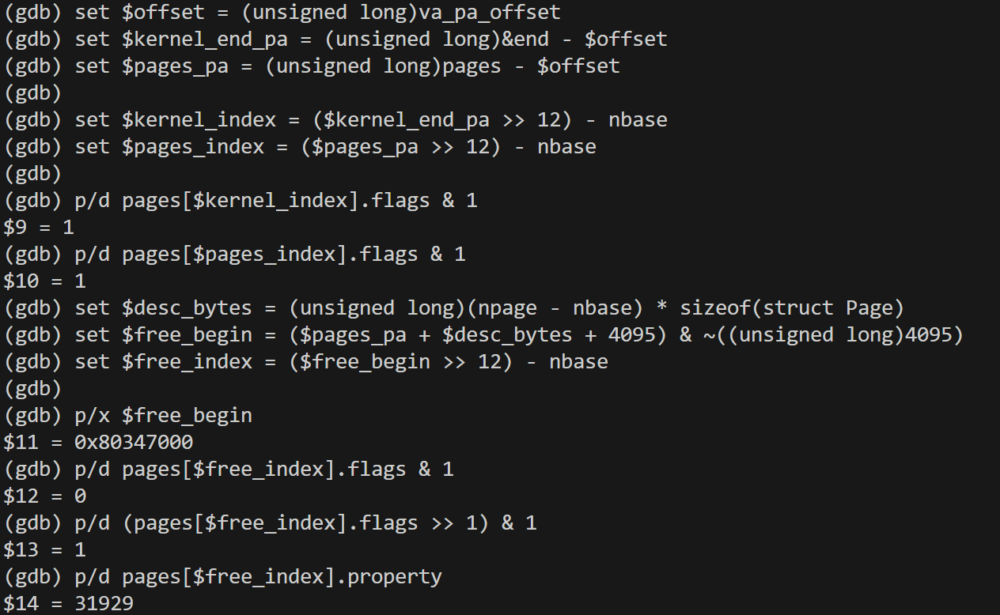

截图与日志用于支持全局变量、地址转换和页面状态检查；单张截图只证明实际展示的项目，其他项目应引用日志。

继续执行自检后，终端不再输出。此时可在 GDB 中用 Ctrl+C 暂停，通过 `info registers pc`、`x/6i $pc` 和 `si` 检查是否执行最终循环。若反汇编为单条自跳转，单步后 PC 不变是循环行为，不是初始化失败的证据。

### 9. 双重 GDB 的环境与调试对象

双重 GDB 分别控制两个不同层次：宿主机 `/usr/bin/gdb` 调试 x86-64 的 QEMU 进程；`riscv64-unknown-elf-gdb` 通过 QEMU 的远程接口调试 RISC-V 内核。宿主 GDB 暂停 QEMU 时，客体 GDB 仍显示 `Continuing.` 是正常现象。

本次使用的调试版模拟器：

```text
~/OSopt/qemu-4.1.1/riscv64-softmmu/qemu-system-riscv64
QEMU emulator version 4.1.1
ELF 64-bit，x86-64，with debug_info，not stripped
readelf 输出包含 .debug_info 和 .debug_line
```

本次内核符号记录为：

```text
ffffffffc0200000 T kern_entry
ffffffffc02000d8 T kern_init
ffffffffc0205000 D boot_page_table_sv39
ffffffffc0205000 D bootstacktop
```

`bootstacktop` 与页表起点相同，并不意味着栈和页表重叠：该符号表示向低地址增长的栈的上边界，而页表从此处向高地址存放。

本轮主要证据：

- [内核符号](docs/logs/a-paging-symbols.log)
- [QEMU 源码位置记录](docs/logs/a-qemu-source-locations.log)
- [成功的宿主 GDB 调试日志](docs/logs/a-qemu-pagewalk-body.log)

`a-qemu-pagewalk.log`、`a-qemu-pagewalk-retry.log`、`a-ucore-pagewalk.log`、`a-build.log` 均为本地历史记录，未随本次提交交付，不列为可下载附件或已交付补充材料。它们不能替代已交付的成功日志 `a-qemu-pagewalk-body.log`，也不作为本报告已验证结论的必需证据。

### 10. 断点问题与修正

最初在 `riscv_cpu_tlb_fill` 函数入口设置断点，停在 `cpu_helper.c:438` 的左花括号处。曾出现以下异常组合：当前帧 `address` 看似宿主地址、`access_type` 为未知枚举、`mmu_idx` 为很大数值，而调用者帧明确传入 `addr=4096`、`MMU_INST_FETCH` 和 `mmu_idx=3`。

这些输出说明该停止位置的形参显示不可靠。结合改用函数体断点后参数恢复正常，判断问题与函数序言执行位置及调试信息的变量位置描述有关，不能据此认定客体页表或 QEMU 内存损坏。

修正方法是在已完成参数和局部变量初始化的位置断下：

```gdb
break /home/gjhjz/OSopt/qemu-4.1.1/target/riscv/cpu_helper.c:451
```

该行是：

```c
ret = get_physical_address(env, &pa, &prot, address, access_type, mmu_idx);
```

第一次无条件停止时，实际得到：

```text
address = 4096，即 0x1000
access_type = MMU_INST_FETCH
mmu_idx = 3
```

随后对该断点增加目标虚拟页条件。本次会话中断点编号为 1：

```gdb
condition 1 (address & 0xfffffffffffff000ULL) == 0xffffffffc0200000ULL
continue
```

再次命中时得到目标内核取指访问。源码行号与地址均针对本次版本；重新构建或换版本后应重新定位。

另一个排查现象是：在宿主 GDB 中按 Ctrl+C 后，当前线程停在 `__ppoll()`，此时 `info args` 只显示宿主事件循环参数，访问 `address` 会提示不在当前上下文。这不代表翻译函数没有该参数，而是当前栈帧不属于该函数。应等待正确断点，不能在任意停止位置读取其他函数的局部变量。

### 11. Sv39 页表遍历实测

#### 11.1 捕获内核虚拟地址取指

在 `riscv_cpu_tlb_fill` 的函数体断点处，实测：

| 项目 | 实际值 |
|---|---|
| 目标虚拟地址 | `0xffffffffc02000d8`，对应本次 `kern_init` |
| 访问类型 | `MMU_INST_FETCH` |
| `mmu_idx` | 1，对应本次 S 模式访问路径 |
| `env->satp` | `0x8000000000080205` |

将目标保存到宿主 GDB 便利变量：

```gdb
set $target_va = address
set $pa_out = &pa
set $prot_out = &prot
```

这些便利变量属于当前宿主 GDB 会话，其中指针只用于相应调用仍有效的期间，不应在退出或重启后复用。

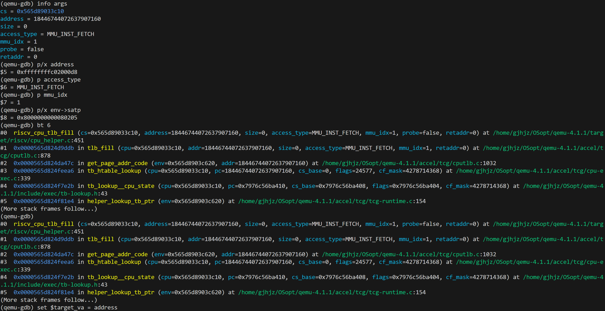

对本次 `satp` 解码：MODE 为 8，即 Sv39；ASID 为 0；根页表 PPN 为 `0x80205`，因此根页表物理地址为 `0x80205000`。这与内核输出的启动页表物理地址一致。

#### 11.2 读取根页表项

在 `cpu_helper.c:254` 设置临时断点，此时 `pte` 已从客体物理内存读取，`ppn` 的赋值尚未执行：

```gdb
tbreak /home/gjhjz/OSopt/qemu-4.1.1/target/riscv/cpu_helper.c:254
continue
info args
p levels
p ptidxbits
p ptesize
p i
p ptshift
p/x base
p/x addr
p/x idx
p/x pte_addr
p/x pte
next
p/x ppn
```

实测结果：

| 变量 | 值 | 含义 |
|---|---|---|
| `levels` | 3 | Sv39 支持三级页表 |
| `ptidxbits` | 9 | 每级索引 9 位 |
| `ptesize` | 8 | 每项 8 字节 |
| `i` | 0 | QEMU 遍历循环第一次迭代，对应最高级页表 |
| `ptshift` | 18 | 当前级下方的虚拟页号位数 |
| `base` | `0x80205000` | 根页表物理基址 |
| `idx` | `0x1ff` | VPN[2]，即第 511 项 |
| `pte_addr` | `0x80205ff8` | 根页表项物理地址 |
| `pte` | `0x200000cf` | 读取的页表项 |
| `ppn` | `0x80000` | 执行赋值后得到的 PTE 物理页号 |

地址核算如下：

```text
idx = (0xffffffffc02000d8 >> 30) & 0x1ff = 0x1ff
pte_addr = 0x80205000 + 511 × 8 = 0x80205ff8
ppn = 0x200000cf >> 10 = 0x80000
```

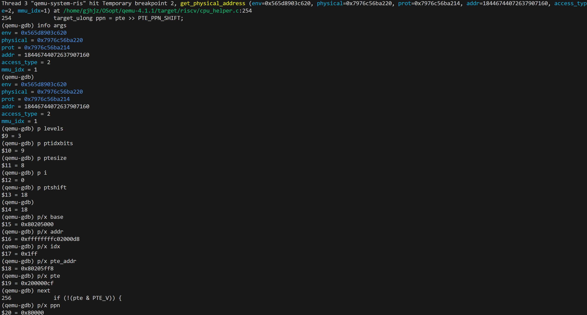

#### 11.3 叶子判定、权限与大页

PTE 低位 `0xcf` 表示 V、R、W、X、A、D 为 1，U、G 为 0。该项有效并具有访问权限，因此是叶子项，不会沿下一层页表继续遍历。

本次按 `next` 观察有效性、叶子/非叶子、非法权限组合、特权级与大页对齐检查的执行路径，并成功继续到物理地址生成处。最高级页表的叶子项对应 1 GiB 映射；其物理页号低 18 位为零，满足该级大页的对齐要求。

因此，“Sv39 是三级页表”不意味着每次转换必定读取三级页表。本次仅在根级读取叶子项便完成转换。变量 `i=0` 是循环编号，不能写成“在最低级页表找到 4 KiB 叶子项”。

#### 11.4 计算物理地址

在 `cpu_helper.c:334` 前停止，源码为：

```c
target_ulong vpn = addr >> PGSHIFT;
*physical = (ppn | (vpn & ((1L << ptshift) - 1))) << PGSHIFT;
```

本次实际值：

```text
vpn = 0xffffffffc0200
ppn = 0x80000
ptshift = 18
vpn & ((1ULL << ptshift) - 1) = 0x200
```

执行赋值后：

```text
*physical = 0x80200000
目标地址的低 12 位 = 0xd8
完整目标物理地址 = 0x80200000 | 0xd8 = 0x802000d8
```

这里该叶子转换路径返回的是目标所属的 4 KiB 物理页基址，不能把它误写为完整取指地址。1 GiB 映射中的低层虚拟页号补入物理页号，页内偏移保持不变。

执行 `finish` 返回调用者，观察到返回值为 0；通过事先保存的输出参数指针，得到物理页基址 `0x80200000`、权限值 `0x7`。后续进入 `tlb_set_page` 进一步印证了该结果。

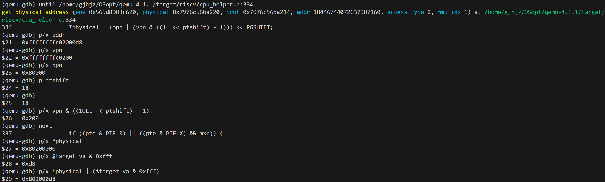

### 12. QEMU 软件 TLB 填充与复核

#### 12.1 调用链

本次调用栈显示以下关系：

```text
tb_htable_lookup
  -> get_page_addr_code
     -> tlb_fill
        -> riscv_cpu_tlb_fill
           -> get_physical_address
           -> tlb_set_page
              -> tlb_set_page_with_attrs
```

其中 `get_physical_address` 与 `tlb_set_page` 是 `riscv_cpu_tlb_fill` 内先后执行的调用，并非前者调用后者。TB 是 QEMU 的翻译块缓存概念，不能与地址转换 TLB 混为一谈。

#### 12.2 填充参数

在 `accel/tcg/cputlb.c:847` 的函数体位置设置临时断点：

```gdb
tbreak /home/gjhjz/OSopt/qemu-4.1.1/accel/tcg/cputlb.c:847
continue
info args
p/x vaddr
p/x paddr
p/d size
p mmu_idx
bt 5
next
```

实测参数：

```text
vaddr   = 0xffffffffc0200000
paddr   = 0x80200000
prot    = 7
mmu_idx = 1
size    = 4096
```

`next` 后到达该函数末尾第 849 行，说明 `tlb_set_page_with_attrs` 调用已经返回。

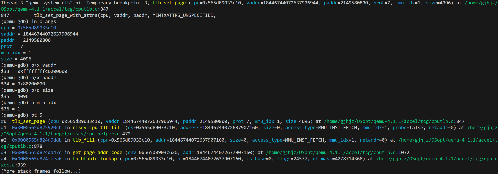

这里的 `size=4096` 表示本次 QEMU 软件 TLB 填充接口传入的页大小，不会改变原始根页表叶子项的 1 GiB 映射含义。不能根据该参数认定客体使用了最低级 4 KiB 叶子页表。

#### 12.3 填充后命中条件复核

返回 `get_page_addr_code` 后，在第 1036 行设置临时断点：

```gdb
tbreak /home/gjhjz/OSopt/qemu-4.1.1/accel/tcg/cputlb.c:1036
continue
bt 5
p/x addr
p/x entry->addr_code
p/x $target_va
next
```

观察到：

```text
addr             = 0xffffffffc02000d8
entry->addr_code = 0xffffffffc0200000
$target_va       = 0xffffffffc02000d8
```

第 1036 行为：

```c
assert(tlb_hit(entry->addr_code, addr));
```

执行 `next` 后到达第 1039 行：

```c
if (unlikely(entry->addr_code & (TLB_RECHECK | TLB_MMIO))) {
```

因此，本次 TLB 填充后检查通过，目标地址所在虚拟页与取指 TLB 项对应。

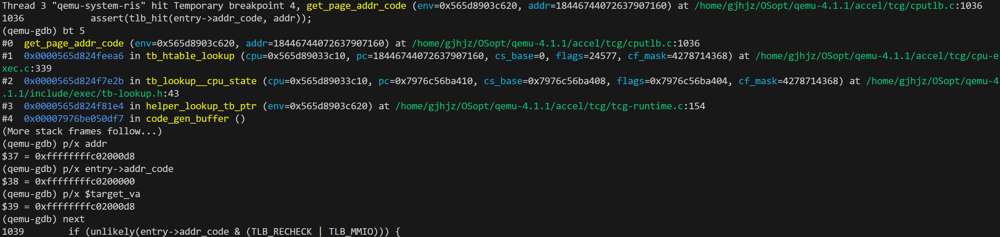

**本节证据仅证明同一次访问填充后的断言通过。**联合版本中另一次调用在第 1030 行直接命中并跳过填充分支的证据已补充于第 18 节，两者不能互相替代。到达第 1039 行本身也不表示已经观察了该行条件的执行结果。

#### 12.4 结束会话与日志保存

本次执行以下命令结束宿主侧调试：

```gdb
disable breakpoints
set logging off
detach
quit
```

退出后通过 `ls -lh` 和 `tail -60` 确认 `docs/logs/a-qemu-pagewalk-body.log` 存在，大小约 13 KiB。日志尾部保存了 TLB 填充参数、调用栈、取指地址、`entry->addr_code` 及到达第 1039 行的记录。GDB 退出不影响已经写入磁盘的证据。

### 13. 分页前后与软件、硬件实现的联系

本次捕获的早期访问是 `0x1000`、`MMU_INST_FETCH`、`mmu_idx=3`；后续内核访问是 `0xffffffffc02000d8`、`MMU_INST_FETCH`、`mmu_idx=1`，并实际读取到 Sv39 模式的 `satp`。

前一条历史记录证明捕获了早期 M 模式取指上下文，但没有单独记录该次 `satp` 和转换返回值，不能仅据此声称完成了分页开关前后的全部对照。联合版本的 Bare/Sv39 寄存器状态及高地址入口对照已补充于第 17 节；这不追溯补齐旧会话中没有采集的数据。源码分析表明，QEMU 对 M 模式取指采用不经 Sv39 页表遍历的路径；本次 S 模式目标取指则实际经过了上述根页表叶子转换。

QEMU 通过软件结构模拟地址转换和权限检查，并借助软件 TLB 缓存翻译结果。真实 CPU 同样需要遵守 RISC-V 的地址翻译、权限和异常语义，但一般由硬件 MMU、页表遍历机制和 TLB 实现，内部结构与替换策略不由本次 QEMU 软件结构直接决定。

本实验能够观察 QEMU 中相应函数与软件缓存条目，不能由此推断真实处理器的 TLB 容量、硬件命中延迟或具体替换算法。QEMU 的 TB 缓存还可能复用已经翻译的指令块，因此重复执行同一段客体指令不一定再次经过本次记录的 C 函数调用链。

### 14. AI 辅助过程、问题与验证

AI 辅助工作包括初始化规格整理、页号和地址语义解释、实现草案、编译问题分析、双重 GDB 调试步骤，以及输出解读。实际执行和验证由我在本地完成。

| 过程 | 发现与修正 | 验证依据 |
|---|---|---|
| 物理页初始化 | 区分 `npage` 和 DRAM 页数，保留固件、内核及描述符空间 | 内存布局输出和算术核对 |
| 初次构建 | 未完成的 Best Fit 模块引用未定义状态；临时排除该文件 | 编译错误及后续 First Fit 自检 |
| 宿主调试器 | `sudo gdb` 最初不可用，需要安装宿主 GDB | 后续成功附加 QEMU 并读取源码 |
| 函数入口断点 | 入口形参显示异常，基于异常参数的条件断点不可靠 | 改在第 451 行停止后参数与调用者一致 |
| 停止线程上下文 | `__ppoll` 栈帧中无法查看翻译函数形参 | 在正确函数体断点处读取参数 |
| 地址解释 | 区分转换返回的物理页基址和完整取指地址 | `0x80200000 + 0xd8 = 0x802000d8` |
| TLB 证据解释 | 区分填充后断言与独立调用直接命中 | 历史会话为 1036→1039；联合版本会话为 1030→1039 |
| 分页切换断点 | 低地址断点跨越 satp 更新后无法重新插入；修正为在切换前禁用该断点 | 首次失败日志和高地址入口补录均保留 |
| 环境兼容性 | C 环境与 A 不同，未直接照搬 C 的控制台转接脚本 | A 的 QEMU 4.1.1 普通评分获得 20/20 |

### 15. 原理联系与未覆盖内容

| 实验概念 | 原理联系 |
|---|---|
| 页描述符 | OS 用元数据管理物理页，元数据自身也需要占用并保护内存 |
| 保留区与空闲区 | 初始化建立资源边界，避免分配器覆盖固件、内核和自身状态 |
| 物理分配与虚拟映射 | 前者管理资源，后者决定地址访问关系，职责不同 |
| Sv39 多级页表 | 每级索引 9 位，叶子可以出现在不同层级，大页可提前结束遍历 |
| 访问权限 | 有效位、读写执行权限、特权级及对齐共同决定转换能否成功 |
| TLB | 缓存转换结果，减少重复页表查询；已分别观察填充、填充后复核和后续查询直接命中 |
| 管理器接口 | 初始化可用区逻辑与 First Fit、Best Fit、Buddy 的策略分离 |

本部分没有实现进程独立地址空间、按需分页、页面置换或交换，也没有验证所有非法 PTE、权限故障、A/D 位更新、多核并发和 TLB 失效场景。

### 16. 联合版本在 A 环境的回归验证

#### 16.1 获取与检查 C 的提交

2026-10-19，`git fetch origin` 将远程跟踪分支从 `a3574e2` 更新至 `b5c05e9`，提交说明为 `Buddy_System design and implementation`。该提交位于本地基线之后，可快进获取。

对 `pmm.c`、Makefile 和评分脚本的差异检查表明，本批公共入口仅增加 `PMM_BUDDY` 条件包含与管理器选择：定义宏时选择 `buddy_pmm_manager`，否则仍选择 `best_fit_pmm_manager`；A 的 `page_init()`、Makefile 和 `tools/grade.sh` 在该提交中未改变。

C 的实现与其自检属于尚文轩的贡献，Best-Fit 实现及行为测试属于陈铭宇的贡献；本节记录 A 在自己的环境进行的集成复测，不把队友实现归为本人完成。

#### 16.2 Buddy 构建与运行

在仓库根目录执行以下命令，保留构建和运行输出：

```bash
set -o pipefail
make clean
make DEFS=-DPMM_BUDDY \
    2>&1 | tee docs/logs/a-after-c-buddy-build.log
make qemu DEFS=-DPMM_BUDDY \
    QEMU="$HOME/OSopt/qemu-4.1.1/riscv64-softmmu/qemu-system-riscv64" \
    2>&1 | tee docs/logs/a-after-c-buddy-run.log
```

实际输出摘录：

```text
memory management: buddy_pmm_manager
[Buddy] initial free pages: 31928
[Buddy] split six levels and merge back: PASS
[Buddy] powers of two and rounded requests (3 -> 4): PASS
[Buddy] non-buddy neighbours, fragmentation, exhaustion: PASS
[Buddy] unaligned 37-page init, multiple ranges, no lost pages: PASS
[Buddy] 1024 mixed operations with occupancy oracle: PASS
[Buddy] state restored: 31928 -> 31928 free pages: PASS
check_alloc_page() succeeded!
```

该结果支持本轮 Buddy 所列自检场景通过，测试后空闲页总量恢复。它不代表所有非法调用、任意负载或并发场景均已验证。Buddy 请求向上取整和完整块释放约定详见 [C 个人章节](docs/parts/c-buddy.md)，不能用 Best-Fit 的部分区间释放契约替代。

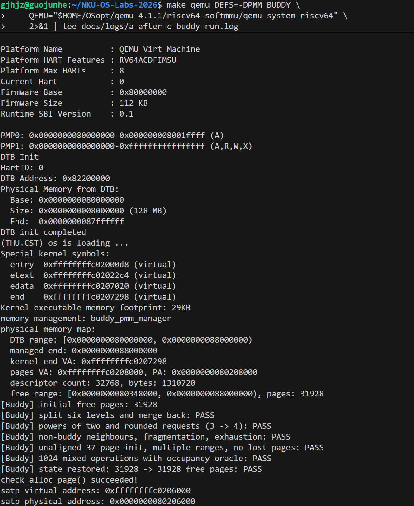

#### 16.3 恢复默认 Best-Fit 与教师评分

退出 QEMU 后先清理，避免沿用 Buddy 编译宏产生的对象文件：

```bash
make clean
make 2>&1 | tee docs/logs/a-after-c-best-fit-build.log
make qemu \
    QEMU="$HOME/OSopt/qemu-4.1.1/riscv64-softmmu/qemu-system-riscv64" \
    2>&1 | tee docs/logs/a-after-c-best-fit-run.log
```

实际启用 `best_fit_pmm_manager`，最佳匹配、精确匹配及同大小选择、拆分、前后及双侧合并、碎片与耗尽失败、多轮恢复均 PASS，末尾为：

```text
[Best-Fit behavior] original state restored: PASS (31928 free pages)
[Best-Fit behavior] ALL PASS
check_alloc_page() succeeded!
```

退出 QEMU 后执行：

```bash
make grade \
    QEMU="$HOME/OSopt/qemu-4.1.1/riscv64-softmmu/qemu-system-riscv64" \
    2>&1 | tee docs/logs/a-after-c-grade.log
```

评分实际结果：

```text
lab2 injection complete
  -check page init:                          OK
  -check best fit:                           OK
Total Score: 20/20
```

A 环境使用普通评分命令即可获得结果，没有使用 C 的 `qemu-grade-console.py`。本轮回归环境为 WSL Ubuntu 20.04、SiFive GCC 10.2.0、QEMU 4.1.1、OpenSBI v0.4，区别于 C 的 QEMU 6.2.0 / OpenSBI 1.3 环境。

教师 20/20 仅覆盖 Page Init 和 Best-Fit 评分项，不评分 Buddy、双重 GDB 或报告。Buddy 由独立自检提供证据。评分在 `/tmp/lab2_grade` 的注入版本中执行；后续地址调试前重新 `make`，使用仓库自身的默认内核。

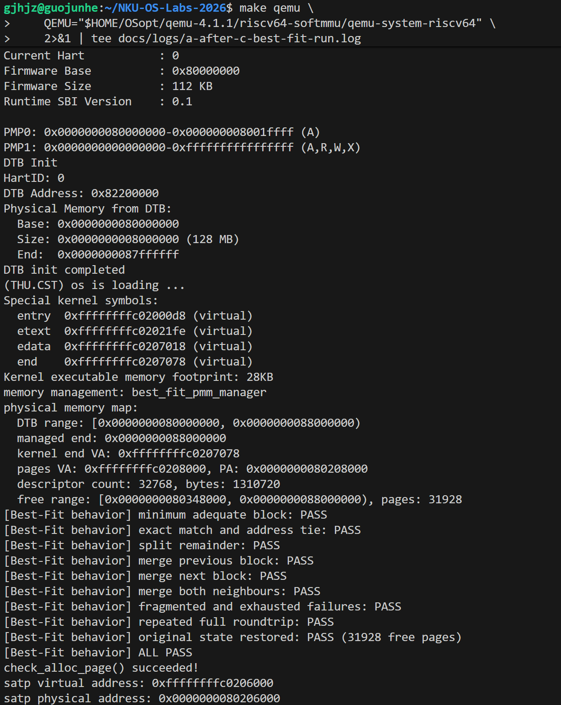

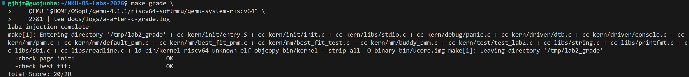

#### 16.4 联合版本布局与历史版本对比

| 项目 | 历史 First-Fit | 联合版本 Buddy | 联合版本 Best-Fit |
|---|---|---|---|
| `kern_init` VA | `0xffffffffc02000d8` | `0xffffffffc02000d8` | `0xffffffffc02000d8` |
| 内核 `end` VA | `0xffffffffc0206078` | `0xffffffffc0207298` | `0xffffffffc0207078` |
| 描述符数组 PA | `0x80207000` | `0x80208000` | `0x80208000` |
| 描述符数量 | 32768 | 32768 | 32768 |
| 描述符字节数 | 1310720 | 1310720 | 1310720 |
| 空闲起点 PA | `0x80347000` | `0x80348000` | `0x80348000` |
| 初始空闲页数 | 31929 | 31928 | 31928 |
| 根页表 PA | `0x80205000` | `0x80206000` | `0x80206000` |

三种构建的管理末端均为 `0x88000000`。联合版本的算术核对为：

```text
描述符末端 = 0x80208000 + 0x140000 = 0x80348000
空闲页数 = (0x88000000 - 0x80348000) / 4096 = 31928
总页数 = 512（固件等预留）+ 8（内核及对齐）+ 320（描述符）+ 31928 = 32768
```

新增代码改变链接布局，初始可用页数减少一页，不是测试泄漏。旧截图中的 `0x80205000`、31929 等数值继续对应其历史构建，不能覆盖成新值。

### 17. 联合版本分页切换前后实测

#### 17.1 定位启动指令

本节使用联合版本的默认 Best-Fit 内核。源码、符号与反汇编分别记录在：

- [启动源码](docs/logs/a-entry-source-after-c.log)
- [启动反汇编](docs/logs/a-entry-disassembly-after-c.log)
- [新版本符号](docs/logs/a-paging-symbols-after-c.log)

本次关键位置为：

| 指令/符号 | ELF 高地址 | 分页前对应物理地址 |
|---|---|---|
| `kern_entry` | `0xffffffffc0200000` | `0x80200000` |
| `csrw satp,t0` | `0xffffffffc0200034` | `0x80200034` |
| `sfence.vma` | `0xffffffffc0200038` | `0x80200038` |
| 设置 SP 的 `lui` | `0xffffffffc020003c` | `0x8020003c` |
| `jr t0` | `0xffffffffc0200048` | `0x80200048` |
| `kern_init` | `0xffffffffc02000d8` | `0x802000d8` |

源码以 `lui` 等指令取得根页表链接地址，减去虚实偏移得到物理地址，再右移 12 位获得 PPN，与 Sv39 MODE 字段组合后写入 `satp`。写入翻译配置和执行 `sfence.vma` 是两个不同操作，不能把 `csrw satp` 本身解释为完成全部翻译缓存同步。

#### 17.2 分页启用前的观察

终端 1 启动 `make debug`，显式指定上述 QEMU 4.1.1；终端 2 运行 `make gdb`。本轮只使用客体 GDB，不同时附加宿主 GDB。

在新会话中执行：

```gdb
set pagination off
set logging file docs/logs/a-paging-transition-after-c.log
set logging overwrite off
set logging on
hbreak *0x80200034
continue
info registers pc t0 t1 sp
p/x $satp
x/6i $pc
x/gx 0x80206000
x/gx 0x80206ff8
```

实际结果：

```text
pc   = 0x80200034
当前指令：csrw satp,t0
satp = 0x0
t0   = 0x8000000000080206
t1   = 0x8000000000000000
sp   = 0x8001bd80
根页表第 0 项：0x0000000000000000
根页表第 511 项：0x00000000200000cf
```

此时写 `satp` 的指令尚未执行，MODE 为 Bare。根页表地址计算为 `0x80206000 + 511 × 8 = 0x80206ff8`。

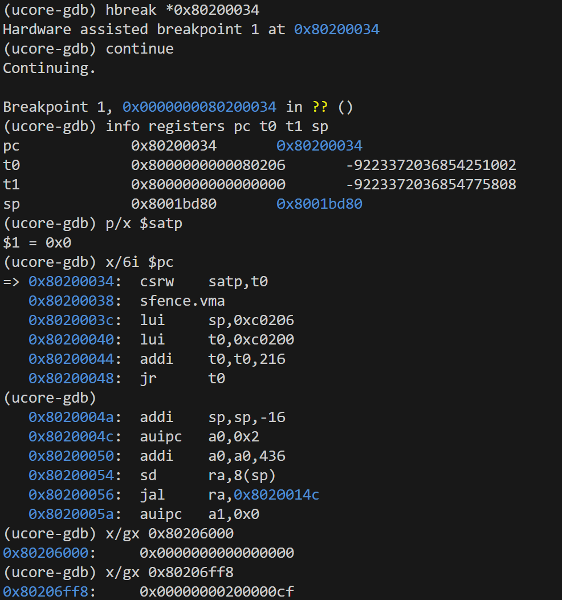

#### 17.3 首次切换时的断点问题

首次在保留低地址断点 1 的情况下设置高地址断点 2 并继续，出现：

```text
Cannot insert hardware breakpoint 1:
Cannot access memory at address 0x80200034.
pc = 0x80200038
satp = 0x8000000000080206
```

此时执行 `x/6i $pc` 无法读取低地址 `0x80200038`，但通过高地址 `0xffffffffc0206ff8` 能读到 PTE `0x200000cf`。这说明 `satp` 已写入，并且分页切换影响了调试器的低地址访问与断点重插入。根页表第 0 项为空，而高地址映射存在，与上述现象一致。

这是调试器报告的断点/内存访问问题，不能单凭该提示认定发生了客体取指异常。第一次禁用全部断点后继续运行，最终 Ctrl+C 停在 `kern_init` 的循环：

```text
pc = 0xffffffffc0200110
j 0xffffffffc0200110
```

首次记录证明最终进入高地址循环，但没有捕获函数入口。它也没有直接解释 QEMU 跨越切换区间的全部内部机制，不能据此推广为任意硬件平台都能使用相同的无低地址映射启动序列。

原始问题记录保留在 [首次分页切换日志](docs/logs/a-paging-transition-after-c.log)，不以成功补录覆盖。

#### 17.4 修正断点方案并捕获高地址入口

新会话将日志保存到 `a-paging-transition-confirm.log`。在 `0x80200034` 命中并记录分页前状态后，**先禁用低地址断点**：

```gdb
disable 1
hbreak *0xffffffffc02000d8
info breakpoints
continue
```

本次 `info breakpoints` 显示断点 1 为 `Enb n`，断点 2 为 `Enb y`；继续后成功命中 `kern_init` 第一条指令：

```text
Breakpoint 2, kern_init () at kern/init/init.c:30
pc   = 0xffffffffc02000d8
sp   = 0xffffffffc0206000
satp = 0x8000000000080206
&boot_page_table_sv39 = 0xffffffffc0206000
*(根页表第 511 项 VA 0xffffffffc0206ff8) = 0x200000cf
```

反汇编的当前指令是 `auipc a0,0x7`；`addi sp,sp,-16` 位于后面的 `kern_init+16`，尚未执行。GDB 显示源码行 `memset(...)` 不代表已经执行 `memset`。

| 对照项 | 写入 satp 前 | 高地址 kern_init 入口 |
|---|---|---|
| PC | `0x80200034` | `0xffffffffc02000d8` |
| SP | `0x8001bd80` | `0xffffffffc0206000` |
| satp | `0x0` | `0x8000000000080206` |
| 翻译配置 | Bare | Sv39，ASID=0，根页表 PA=`0x80206000` |

SP 与根页表 VA 相同是两段存储区域的边界关系：栈向低地址增长，页表从该地址向高地址存放，不意味着栈和页表重叠。

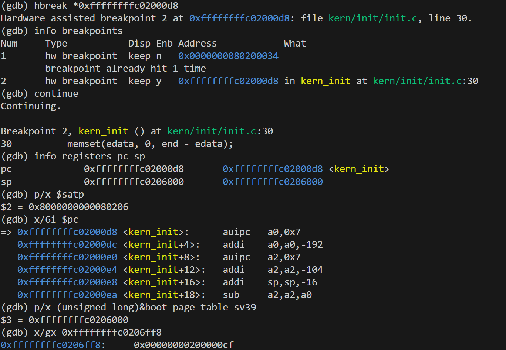

证据：[成功补录日志](docs/logs/a-paging-transition-confirm.log)。本节记录配置状态与执行位置的前后对照；GDB 内存读取不能代替真实访存的页表遍历或 TLB 命中证据。

### 18. 联合版本取指地址查询直接命中软件 TLB

#### 18.1 观察目标与条件断点

本轮重新启动 QEMU，通过宿主 GDB 附加进程，客体 GDB 只执行 `continue`，不设置高地址客体断点。与历史第 12 节不同，本轮在 `get_page_addr_code()` 判断之前等待已有 TLB 项匹配，而不是在填充后断言处停止。

宿主 GDB 的关键设置如下：

```gdb
set pagination off
set logging file /home/gjhjz/NKU-OS-Labs-2026/docs/logs/a-qemu-tlb-hit-after-c.log
set logging overwrite off
set logging on
break /home/gjhjz/OSopt/qemu-4.1.1/accel/tcg/cputlb.c:1030 if ((addr & 0xfffffffffffff000ULL) == 0xffffffffc0200000ULL) && (entry->addr_code == (addr & 0xfffffffffffff000ULL))
continue
```

该条件只筛选目标页已有取指标签匹配的调用，不修改 TLB 项、不伪造命中，也不能用来统计所有访问的命中率。

#### 18.2 实际命中与跳过填充分支

实际在第 1030 行停止：

```c
if (unlikely(!tlb_hit(entry->addr_code, addr))) {
```

观察命令和结果：

```gdb
p/x addr
p/x entry->addr_code
p/d mmu_idx
p/x (addr & 0xfffffffffffff000ULL)
p (entry->addr_code == (addr & 0xfffffffffffff000ULL))
```

```text
addr = 0xffffffffc02000d8
entry->addr_code = 0xffffffffc0200000
mmu_idx = 1
addr 所在虚拟页 = 0xffffffffc0200000
相等判断 = 1
```

随后执行一次 `next`，直接到达第 1039 行：

```c
if (unlikely(entry->addr_code & (TLB_RECHECK | TLB_MMIO))) {
```

因此，本次调用没有进入第 1031～1036 行的未命中处理，也没有执行其中的 `tlb_fill()` 和填充后断言。前后调用栈均包含 `get_page_addr_code`、`tb_htable_lookup`、`tb_lookup__cpu_state`、`tb_find`、`cpu_exec`，支持这是 QEMU 取指地址查询路径中的观察。

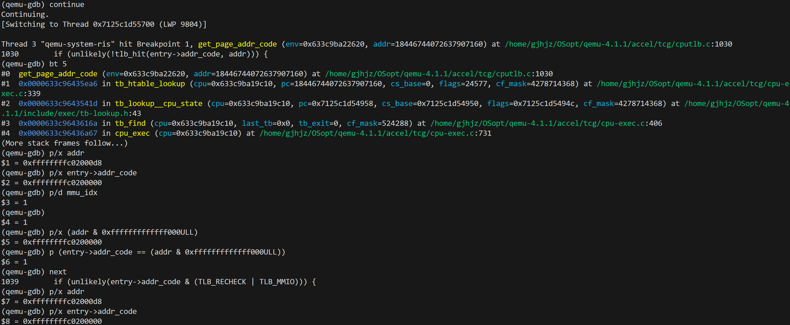

成功日志：[a-qemu-tlb-hit-after-c.log](docs/logs/a-qemu-tlb-hit-after-c.log)。退出后通过 `ls -lh`、`tail -80` 确认约 3.1 KiB 日志已经保存，包含条件断点、地址比较、单步后的行号和调用栈。

#### 18.3 与填充后复核的区别及结论边界

| 证据 | 停止位置与路径 | 能证明的内容 |
|---|---|---|
| 历史页表遍历及填充 | `get_physical_address` → `tlb_set_page` → 第 1036 行断言 | 一次未命中路径的转换、填充及填充后复核 |
| 联合版本直接命中 | 第 1030 行 → 第 1039 行 | 本次查询进入判断时已有匹配项，跳过未命中处理 |

本次可表述为“后续取指地址查询复用了已有软件 TLB 项”。不能写成“CPU 第二次执行 kern_init 时命中”：QEMU 内部可能对同一地址进行多次查询，日志不能确定客体指令的执行次数。

本轮没有记录该条目最初填充的具体时刻。历史填充证据与本轮命中证据来自不同版本和会话，不能拼接成同一会话的严格时间序列；两者分别验证对应路径。也不能据此推断真实硬件 TLB 的性能、替换策略或整个程序的命中率。

### 19. 证据索引、交接与最终核对

#### 19.1 本轮新增材料

| 材料 | 文件 |
|---|---|
| 联合回归源码版本 | [a-after-c-revision.log](docs/logs/a-after-c-revision.log) |
| Buddy 构建及运行 | [构建](docs/logs/a-after-c-buddy-build.log)、[运行](docs/logs/a-after-c-buddy-run.log) |
| Best-Fit 构建及运行 | [构建](docs/logs/a-after-c-best-fit-build.log)、[运行](docs/logs/a-after-c-best-fit-run.log) |
| 教师评分 | [a-after-c-grade.log](docs/logs/a-after-c-grade.log) |
| 新版符号与启动指令 | [符号](docs/logs/a-paging-symbols-after-c.log)、[源码](docs/logs/a-entry-source-after-c.log)、[反汇编](docs/logs/a-entry-disassembly-after-c.log) |
| 分页切换首次记录与成功补录 | [首次记录](docs/logs/a-paging-transition-after-c.log)、[入口补录](docs/logs/a-paging-transition-confirm.log) |
| 软件 TLB 直接命中 | [a-qemu-tlb-hit-after-c.log](docs/logs/a-qemu-tlb-hit-after-c.log) |

图片路径采用仓库约定名称；汇总时核对实际文件名和相对链接，不用其他实验图片替代。`a-build.log`、`a-qemu-pagewalk-retry.log`、`a-qemu-pagewalk.log`、`a-ucore-pagewalk.log` 为本地历史记录，未随本次提交交付，不再列为待补交附件。

#### 19.2 当前完成情况

- A 的物理页初始化及历史 First-Fit 验证已完成。
- 历史版本的 Sv39 根级大页遍历、物理地址计算、软件 TLB 填充与填充后复核已完成。
- C 接入后的 Buddy、默认 Best-Fit 在 A 环境的本轮回归已完成，教师评分 20/20。
- 联合版本 Bare/Sv39 配置和低/高地址执行位置对照已完成，保留断点问题及修正记录。
- 联合版本一次独立调用直接命中已有取指 TLB 项、跳过填充分支的观察已完成。

这些结果覆盖本章所列任务和观察路径，不等于所有体系结构边界条件或整个实验的全部验收项自动通过。若之后改变源码、编译选项或运行环境，应按变化范围确定是否需要重新验证。

#### 19.3 汇总与本人确认事项

2026-10-20 由 C 按最新个人章节重新汇总 `report.md`。A 的学号及初始化实际 AI 交互记录仍需本人核对和补齐，不能由汇总者猜测填写。

## 成员 B：First-Fit 与 Best-Fit 工作记录

首次记录：2026-10-17；更新：2026-10-19。负责人：成员 B（陈铭宇，2412559）。本文用于交接 First-Fit 分析、Best-Fit 实现及已验证结果，可由 C 汇入最终报告。

当前工程为 lab2 分支，以 A 的初始化提交 79b5791 为基线。B 的代码、测试、学号及验证证据交接提交为 [f8ed38a8d6fb02e1093995eeb99d0744101eabe1](https://github.com/Shaymus-G/NKU-OS-Labs-2026/commit/f8ed38a8d6fb02e1093995eeb99d0744101eabe1)，本文及其他交接文档由后续文档提交补齐。79b5791 本身不包含 B 的成果。

### First-Fit 源码分析

教师提供的 default_pmm.c 已实现 First-Fit，本组不把它记作自行实现的算法。

- default_init() 初始化双向循环空闲链表，将 nr_free 清零。
- default_init_memmap() 接收连续保留页，清除保留标志和引用计数；块头 property 记录页数，设置 PageProperty，并按 Page 地址递增插入链表。此函数本身不合并多次注册的相邻区间。
- default_alloc_pages() 从链表起点顺序查找第一个足够大的块。移除块头；大于请求时，将尾部剩余块放回原位置。成功后减去请求页数，清除返回块头的 PageProperty；找不到连续块时返回 NULL，空闲总量足够也不保证分配成功。
- default_free_pages() 清理释放区间的状态，将新块按地址插回；先合并前邻块，再合并后邻块。nr_free 只增加本次释放的页数，合并不增加总空闲量。
- default_nr_free_pages() 返回空闲页数，default_check() 调用教师检查验证分配与回收。

例子：按地址排列的两个互不相邻空闲块，低地址块有 8 页，高地址块有 5 页。请求 4 页时，First-Fit 选 8 页块并剩 4 页；Best-Fit 选 5 页块并剩 1 页。两次比较应分别从相同初始状态开始。

改进空间：First-Fit 的搜索和释放定位最坏需要线性遍历。可采用 next-fit 游标减少重复扫描，但未必改善碎片；也可增加大小索引或分级链表加速候选查找，代价是额外元数据和拆分、合并时维护多个索引。改用伙伴系统可限制块规格并简化伙伴合并，但会带来内部碎片和不同的请求契约。这些属于分析建议，当前未实现。

### Best-Fit 实现规格

接口保持教师 pmm_manager 不变；输入区间由 A 的 page_init() 注册。只接受合法页区间，n 必须大于 0，零页请求沿用教师 assert 约定。

内部采用独立 static free_area_t。链表按地址递增；PageProperty 标记空闲块头，property 表示块页数，nr_free 表示总空闲页数。块内部页和已分配页不带 PageProperty。

分配遍历空闲块，选最小足够块；大小相同时保留先遇到的低地址块，精确匹配提前停止。成功返回恰好 n 页，尾部剩余块留在原有地址顺序位置；失败不修改链表和计数。

注册和释放复用 best_fit_insert_block()，按地址插入后合并前后相邻块。仅调用者更新 nr_free，合并只改变块结构。注册清除初始保留标志，释放清除引用和块元数据，合并后清除被吸收块头的标记及长度。

默认 manager 已在 pmm.c 的 init_pmm_manager() 中改为 best_fit_pmm_manager。check 指向新增的 best_fit_check_all()，先执行教师原 best_fit_check()，再执行独立文件 best_fit_test.c 中的 best_fit_behavior_check()。教师 basic_check()、best_fit_check() 的内容逐字节保持原样；A 的 page_init() 保持原样，公共 Page 和 pmm_manager 接口未改。

Best-Fit 的改进空间：当前搜索最坏 O(k)，释放插入最坏 O(k)，k 是空闲块数量；精确匹配时可提前结束，但一般仍需遍历。可加入按大小排序的索引或平衡树，并保留地址索引用于合并，代价是更多元数据和更新逻辑。Best-Fit 可能留下难以复用的小块，不能仅凭名称认为碎片必然更少，应根据实际请求序列衡量。当前未实现上述索引优化。

### 验证状态

| 检查 | 当前结果 | 证据 |
|---|---|---|
| 普通 clean build | 通过，Best-Fit 与新增测试均参与编译，成功生成镜像 | [编译日志](docs/logs/b-best-fit-behavior-build.log)、[编译截图](docs/images/b-build.png) |
| A 初始化与 Best-Fit 联合运行 | 正确选中 best_fit_pmm_manager，教师自检成功 | [QEMU 日志](docs/logs/b-best-fit-behavior.log)、[布局截图](docs/images/b-best-fit-layout.png) |
| 补充行为测试 | 最佳匹配、精确匹配、同大小选择、拆分、前后及双侧合并、失败后不变、多轮恢复均通过 | [测试说明](docs/parts/b-best-fit-tests.md)、[测试截图](docs/images/b-best-fit-behavior.png) |
| 教师 make grade | Page Init、Best-Fit 均 OK，总分 20/20 | [评分日志](docs/logs/b-grade-behavior.log)、[评分截图](docs/images/b-grade.png) |
| 学号填写后的最终评分 | 注释填写为 2412559 后再次通过，20/20 | [最终评分及源码摘要](docs/logs/b-final-grade.log) |

验证使用 B 本地 WSL、SiFive GCC 10.2.0、QEMU 4.1.1、OpenSBI v0.4，保持默认 128 MiB RAM。自动验证完成后，用户也手工复现并截图；两次 QEMU 的启动和测试输出一致，仅退出方式不同，评分均为 20/20。重复的 manual 日志已删除，统一引用上述日志。

新增测试后的本次实际布局：

| 项目 | 实际值 |
|---|---|
| 内核 end VA | 0xffffffffc0207078 |
| Page 数组 VA / PA | 0xffffffffc0208000 / 0x80208000 |
| 描述符数量及字节数 | 32768 个，1310720 字节 |
| 初始空闲范围 | [0x80348000, 0x88000000) |
| 自检前、行为测试恢复后的空闲页数 | 均为 31928 |

相对 A 的 First-Fit 版本，新增代码使内核多占一页，初始空闲页数由 31929 变为 31928；这是布局变化，不能继续照抄 A 的固定地址或页数。测试使用运行时计数，并已检查结束后原空闲块、总空闲量及保留页数量恢复。

### 实际问题与处理

1. 原始 Best-Fit 文件缺少 free_list、nr_free 等状态，导致普通构建阻塞。补齐完整模块后，已恢复普通 make，无需继续使用 A 临时排除 Best-Fit 的参数。
2. 首次 make grade 在执行脚本时出现 `tools/grade.sh: 146: Syntax error: ")" unexpected (expecting "then")`，尚未进入算法评分。只读语法检查复现错误，字节检查确认脚本为 CRLF。将其转为 LF，并增加 `.gitattributes` 的 `*.sh text eol=lf` 后，sh -n 通过、教师评分达到 20/20。评分逻辑和断言均未修改。[修复验证日志](docs/logs/b-grade-fixed.log) 属于新增行为测试之前的历史验证，当前最终评分引用 b-grade-behavior.log。

上述是实际遇到的构建和脚本问题。本次没有发现并修复 Best-Fit 算法运行 Bug，不编造其他调试经历。自动 QEMU 日志末尾的 signal 15 是验证程序在检查到输出并等待 5 秒后主动终止空转内核，不代表 panic。

### 交接与复现

从本组实际工程的 Makefile 所在目录执行，确保工具链和 QEMU 已在 PATH：

```bash
make clean
make
make qemu
```

应看到 best_fit_pmm_manager、行为测试 ALL PASS、check_alloc_page() succeeded!。Ctrl+A，松开，再按 X 退出 QEMU 后运行：

```bash
make grade
```

预期两项 OK，总分 20/20。make grade 会清理本地构建并在临时副本中注入测试；不提交临时副本或 bin/、obj/。

实现过程和后续实际交互见 [实现 prompt 记录](docs/prompts/b-best-fit.md)，测试规格见 [测试 prompt 记录](docs/prompts/b-best-fit-tests.md)，交接文件清单及剩余事项见 [B 进度与交接](docs/notes/b-progress.md)。

### 尚待完成的联合事项

- 已接收 C 的 b5c05e9 Buddy 模块并完成复核，在 HEAD 6baf620 上完成 B 本地联合验证；实际切换宏为 PMM_BUDDY，默认保持 Best-Fit。
- 新增行为测试只适用于当前单段空闲区、至少 32 页、无并发的 Best-Fit 启动自检，不作为 Buddy 测试。
- A 已提交 Ubuntu 20.04 / QEMU 4.1.1 共同环境回归及分页、TLB 补证；B 本地 QEMU 4.1.1 回归也已通过。小组报告共同通读和最终提交仍需确认，20/20 不能代替 Buddy、双重 GDB 或报告验收。
- B 的学号已由本人确认，Best-Fit 标记已填写为 2412559；A 的标记由 A 确认。
- B 的代码及证据已提交为 f8ed38a；C 获取 lab2 分支时同时保留后续文档提交，并整合其他成员章节。

本节已具备 B 阶段交接所需的实现、验证和材料索引，不代表小组全部实验已完成。

### 2026-10-19 联合版本回归补充

本轮验证源码为 6baf620ebb414d821c1e5647bdec9cb486636a5e，不修改算法、教师测试或构建配置。环境为 WSL Ubuntu 24.04.5 LTS、SiFive GCC 10.2.0、QEMU 4.1.1、OpenSBI v0.4。

1. make clean 后以 DEFS=-DPMM_BUDDY 构建，运行 buddy_pmm_manager 自检，包含 1024 次混合操作，空闲页恢复 31928 → 31928。
2. 退出后清理并普通构建，运行默认 best_fit_pmm_manager，全部 B 行为测试 PASS，恢复 31928 空闲页。
3. 使用原教师脚本执行普通 make grade，两项 OK、20/20；没有启用 C 的控制台转接脚本。
4. 评分后普通 make 恢复默认构建，并核对符号表已包含 Best-Fit manager、不含 Buddy manager。

Buddy 已复核的释放契约与 Best-Fit 不同：请求 n 页按 2 的幂取整占用，但释放必须传原始 n 和块头；例如 n=3 占用 4 页仍按 3 释放，不支持部分释放。现有框架通过各 manager 的 check 回调执行各自测试，没有套用 Best-Fit 的部分回收检查。

本轮证据：[环境及源码摘要](docs/logs/b-integration-environment.log)、[Buddy 构建](docs/logs/b-integration-buddy-build.log)、[Buddy 自检](docs/logs/b-integration-buddy-run.log)、[Best-Fit 构建与恢复](docs/logs/b-integration-best-fit-build.log)、[Best-Fit 自检](docs/logs/b-integration-best-fit-run.log)、[评分](docs/logs/b-integration-grade.log)。这些是本次 B 实际运行记录，未覆盖 A/C 的历史证据。日志和 B 报告更新已提交为 [c3c4dd962cafea8050a1a1048973172e7408b244](https://github.com/Shaymus-G/NKU-OS-Labs-2026/commit/c3c4dd962cafea8050a1a1048973172e7408b244)，本章及交接文档由后续提交补齐。

本轮发现总报告未汇入 A 的最新章节，汇总脚本简介也有过时状态。初次检查按要求另列工作区根目录 Lab2报告检查问题.md；随后按用户新指令只更新 github/report.md 中 B 的过时部分，原理和历史验证值保持原样，A/C 章、简介及汇总脚本未改。根目录原始报告已恢复保留，不参与本次提交。旧阶段地址、31929 页和未提交时的历史记录不应被批量替换成新值。

## B：Best-Fit 补充行为测试

验证日期：2026-10-18。源码基线为 lab2 分支的 79b5791，B 的实现、默认选择、脚本 LF 规则及本批测试已提交为 [f8ed38a8d6fb02e1093995eeb99d0744101eabe1](https://github.com/Shaymus-G/NKU-OS-Labs-2026/commit/f8ed38a8d6fb02e1093995eeb99d0744101eabe1)，交接文档由后续提交补齐。运行日志中保存了相关源码 SHA256；原行为日志对应填写学号前，最终评分日志对应填写 2412559 后，算法及教师检查未因学号填写改变。

### 文件和入口

- kern/mm/best_fit_test.c：独立行为测试，调用真实的 alloc_pages/free_pages/nr_free_pages 接口。
- kern/mm/best_fit_pmm.h：声明行为测试入口。
- kern/mm/best_fit_pmm.c：增加 best_fit_check_all() 包装函数，check 回调先运行教师原 best_fit_check()，再运行新增测试。
- 教师 basic_check()、best_fit_check() 的函数内容不变；A 的 page_init()、Makefile 和评分断言本批不变。

普通 Best-Fit 启动即执行全部测试，不需要新增构建宏或命令行选项。其他管理器不调用 Best-Fit 的 check 回调。

### 测试边界和隔离

测试只用于启动自检阶段，要求 A 当前初始化提供一个至少 32 页的连续空闲区，且没有并发分配。测试先记录初始空闲块和保留页数量，再通过正常分配接口暂时取出全部空闲页；只在前 32 页构造布局，其余页暂不释放，防止背景空闲块影响选择和失败用例。

测试不直接改写私有 free_list、nr_free，也不重新初始化分配器。每个用例结束前收回其释放的全部页，最后归还整个原始区间。测试观察块头标志、长度、相邻链表连接、引用计数和空闲总数，并核对最终原始块位置、长度及保留页数量。

该测试面向当前单段初始化及 Best-Fit，不声明支持 Buddy、任意初始碎片布局、非法地址或重复释放。空闲区不足 32 页时会明确断言失败，不会跳过后打印成功。

### 覆盖和实际结果

下表偏移单位为页，相对临时取出的区间起点。

| 用例 | 断言重点 | 实际结果 |
|---|---|---|
| 最佳匹配 | 在偏移 0/12/22 处构造 8/5/7 页块，请求 4 页必须返回偏移 12；验证一页余块和回收恢复 | PASS |
| 精确匹配和同大小选择 | 逆地址顺序释放 6/4/4 页块；连续两个 4 页请求按低地址顺序取出，精确匹配不留余块 | PASS |
| 拆分 | 偏移 4 的 10 页块分配 3 页后，余块必须从偏移 7 开始，长度 7 | PASS |
| 向前合并 | 先释放前 3 页，再释放紧邻后 2 页，恢复同一个 5 页块 | PASS |
| 向后合并 | 先释放后 2 页，再释放前 3 页，恢复同一个 5 页块 | PASS |
| 双侧合并 | 先释放左右各 3 页，再释放中间 2 页，恢复 8 页连续块；旧块头标志被清除 | PASS |
| 碎片与耗尽失败 | 三个互不相邻的 4 页块，总量 12；请求 6 页必须失败，请求 13 页也失败；失败后布局和计数不变；耗尽后单页请求失败 | PASS |
| 多轮恢复 | 乱序释放 32 页区间的三部分、合并并整块重新分配，重复 3 轮 | PASS |
| 原始状态恢复 | 归还完整临时区后，原块地址、块数、长度、总空闲量及保留页数量与测试前相同 | PASS |

所有 PASS 均在相应断言执行后输出。QEMU 实际输出为：

```text
[Best-Fit behavior] minimum adequate block: PASS
[Best-Fit behavior] exact match and address tie: PASS
[Best-Fit behavior] split remainder: PASS
[Best-Fit behavior] merge previous block: PASS
[Best-Fit behavior] merge next block: PASS
[Best-Fit behavior] merge both neighbours: PASS
[Best-Fit behavior] fragmented and exhausted failures: PASS
[Best-Fit behavior] repeated full roundtrip: PASS
[Best-Fit behavior] original state restored: PASS (31928 free pages)
[Best-Fit behavior] ALL PASS
check_alloc_page() succeeded!
```

### 实际布局和回归

本次使用现有 WSL、SiFive GCC 10.2.0、QEMU 4.1.1 和默认 128 MiB RAM。

- 内核 end VA：0xffffffffc0207078。
- 描述符起点 PA：0x80208000。
- 空闲区：[0x80348000, 0x88000000)，31928 页。

新增代码让内核比上一版多占用一页；空闲页数相应减少一页。测试读取运行时计数，没有把此前的 31929 页写死。

本次完成 clean build、QEMU 行为断言和教师 make grade 回归。Page Init 和 Best-Fit 两项均 OK，总分 20/20。自动验证程序在内核完成输出并进入末尾循环后，于 5 秒时主动终止 QEMU；日志中的 signal 15 来自该清理动作。

日志：

- [编译日志](docs/logs/b-best-fit-behavior-build.log)
- [QEMU 原始输出及源码摘要](docs/logs/b-best-fit-behavior.log)
- [新增测试后的教师评分](docs/logs/b-grade-behavior.log)
- [填写学号后的最终评分及源码摘要](docs/logs/b-final-grade.log)
- [本轮实际要求和测试规格](docs/prompts/b-best-fit-tests.md)

用户随后手工复现了编译、QEMU 和评分，QEMU 启动及测试输出与上述日志一致，评分同为 20/20。手工复现截图保存在 docs/images/ 的 b-build.png、b-best-fit-layout.png、b-best-fit-behavior.png、b-grade.png；重复的 manual 日志已删除，保留上述日志作为统一记录。

### 手动复现

在 WSL 中进入实际工程目录，工具链和 QEMU 已在 PATH 时执行：

```bash
cd /mnt/d/3nd_grade/OS/lab/lab2/github
make clean
make
make qemu
```

确认出现全部行为 PASS 和 check_alloc_page() succeeded!，截图保存关键结果。退出 QEMU 按 Ctrl+A，松开，再按 X；随后可以运行：

```bash
set -o pipefail
make grade
```

每次重新构建的地址和页数以实际输出为准。make grade 会清理本地构建产物，之后再次手动运行时 make qemu 会重新构建。

### 2026-10-19 接入 Buddy 后回归

在 HEAD 6baf620ebb414d821c1e5647bdec9cb486636a5e 上，B 已先运行 Buddy 自检，再清理构建并切回默认 Best-Fit。本轮 WSL Ubuntu 24.04.5 LTS、GCC 10.2.0、QEMU 4.1.1、OpenSBI v0.4 下，既有 B 测试全部 PASS，空闲页恢复为 31928；普通教师评分仍为 20/20。测试函数和算法均未修改。

使用了独立 B 日志，保留上文 10 月 18 日历史日志和截图，不覆盖 C 的记录。运行后已恢复默认 Best-Fit 构建。本轮没有新增截图。联合回归日志与 B 报告更新提交为 [c3c4dd962cafea8050a1a1048973172e7408b244](https://github.com/Shaymus-G/NKU-OS-Labs-2026/commit/c3c4dd962cafea8050a1a1048973172e7408b244)，本测试说明在后续文档提交中补齐。

- [本轮 Best-Fit 构建与最终默认恢复](docs/logs/b-integration-best-fit-build.log)
- [本轮 Best-Fit 行为测试](docs/logs/b-integration-best-fit-run.log)
- [本轮普通教师评分](docs/logs/b-integration-grade.log)
- [完整复核与两种模式操作记录](docs/notes/b-progress.md)

## 成员 C：Buddy System 设计、实现和验证

负责人：尚文轩，学号 2412456。首次验证：2026-10-19；交接状态更新：2026-10-20。

### 1. 基线、职责和进度判断

初次开发基于 `lab2` 的 `a3574e2b288674f3d0045d6a71753bd94c5327ef`，该基线包含 A 的 `79b5791` 初始化、B 的 `f8ed38a`/`f68e0ee` 以及 A 的调试材料合并。C 的 Buddy 与材料已提交为 `b5c05e9706bedefb18cd7f6c3ad0b2404a8e5869`，并已包含在远程 `lab2`。旧 c-* 日志保留当时未提交工作树的 HEAD 与 SHA256，它们是 10 月 19 日开发阶段的真实记录，不改写为后来的提交状态。

A 已实现 DTB 初始化、页描述符及保留区域处理，提供 First-Fit 实测和 Sv39 大页、TLB 填充证据。B 已实现并验证 Best-Fit。C 在 10 月 19 日补齐 Buddy、自检、两份规格记录和总报告，并在本机回归默认模式。10 月 20 日同步至 `cf881a985919d78a773bd77c09998f324f603d27` 后，已核对 A 的 `cc646e0`/`6baf620` 联合回归与调试补证、B 的 `c3c4dd9`/`cf881a9` 联合验收材料。以下 C 构建数值仍指初次验证；后续联合结果见第 7 节。

### 2. 环境与启用方式

| 项目 | C 本次实际环境 |
|---|---|
| 操作系统 | Windows 上的 WSL Ubuntu 22.04 |
| 工具链 | 用户目录解包安装，GCC 10.2.0 |
| QEMU / 固件 | QEMU 6.2.0 / OpenSBI 1.3 |
| 物理内存 | 默认 128 MiB，DTB 区间 [0x80000000, 0x88000000) |
| 内核页大小 | 4096 字节 |

本环境不同于 A/B 的 QEMU 4.1.1、OpenSBI 0.4；本轮没有在他们的机器复测，不把本机结果说成共同环境验收。

在仓库根目录执行：

```bash
source ~/OSopt/env.sh
make clean
make DEFS=-DPMM_BUDDY
make qemu DEFS=-DPMM_BUDDY
# 退出：Ctrl+A，松开，再 X
```

恢复默认 Best-Fit：

```bash
make clean
make
make qemu
# 退出 QEMU 后，本机评分使用控制台转接：
make grade QEMU='python3 tools/qemu-grade-console.py'
```

一键完成两种模式的构建、启动检查和评分，并留下默认 Best-Fit 构建：

```bash
source ~/OSopt/env.sh
python3 tools/check-buddy.py
```

宏变化不会自动使旧对象失效，手动切换必须先 clean；每次都重新启动，不能在运行中更换管理器。本轮不改 Makefile，保持默认 Best-Fit，仅在 `pmm.c` 增加条件 include 和选择分支。

### 3. 数据结构与接口契约

源码为 `kern/mm/buddy_pmm.c/.h`，导出 `buddy_pmm_manager`。按 0..15 阶组织双向空闲链表，第 k 阶包含 2^k 页，最大单块 32768 页，即 128 MiB；最大块受真实空闲范围和对齐约束，实际不保证存在。

| 页状态 | flags | property |
|---|---|---|
| 保留页 | PG_reserved | 不参与分配 |
| 空闲块头 | PG_property | 实际块页数，必为 2 的幂 |
| 已分配块头 | 私有 BUDDY_ALLOCATED，第 2 位 | 原始请求 n |
| 块内部页 | 无上述块头位 | 0 |

每个状态还有空闲页总数和登记物理页号上下界。无需修改 `struct Page` 或公用管理器接口，私有位只在 Buddy 中解释。以后若公共 flags 增加新用途，需要重新核对第 2 位是否冲突。

`alloc_pages(n)` 返回连续且按实际块大小对齐的物理页块；n=3 时占用 4 页，`nr_free_pages()` 减少 4。调用者必须 `free_pages(base, 3)`，释放按已存原始请求识别整个 4 页块并使计数增加 4。传入 4、内部页指针、重复释放、部分释放均不支持；释放前引用计数必须为 0。非正页数按教师接口使用断言，超最大阶及 SIZE_MAX 请求返回 NULL。

Best-Fit 支持任意长度和部分区间回收，其教师测试不符合 Buddy 的完整块释放契约，因此只通过各管理器自己的 `.check` 调用相应测试。当前是单核启动自检，不包含锁；并发环境需调用方串行化。

### 4. 初始化、分配与释放原理

`page_init()` 仍由 A 实现，Buddy 的 `init_memmap(base,n)` 接受其登记的保留页区间。先清理该区间的描述符，再不断选择同时满足物理页号对齐和剩余长度的最大 2 的幂块。即使空闲起点不对齐、总页数不是 2 的幂，也不会舍弃头部或尾部。登记多个区间时，可在正确伙伴边界进一步合并。

分配首先寻找能够满足取整页数的最低非空阶，移除块头，逐级将右半块放回对应阶链表，保留左半块作为返回块。无可用块时返回 NULL，不改变链表和计数。取整请求存在内部碎片，例如 17 页占用 32 页；Buddy 的价值是规则化拆分和合并，而不是保证每次请求浪费最小。

释放根据原始 n 计算阶数，检查分配头及引用计数，清除分配标记后重复计算：

```c
buddy_ppn = page2ppn(base) ^ (1UL << order);
```

只有伙伴位于当前登记边界、是同阶空闲块头时才移除并合并，继续升阶。比如对齐测试区的偏移 1、2 虽相邻，但 1 的伙伴是 0、2 的伙伴是 3，不能合成 2 页块。

空闲页数在登记、分配、释放时按真实页数改变；拆分和合并只改变结构，不改变空闲总量。生产分配、释放的阶数搜索/合并最多 O(MAX_ORDER)，链表摘取 O(1)；初始化清理描述符 O(n)。启动测试的全结构检查另计，不代表正常分配路径复杂度。

### 5. 测试方法与实际结果

测试位于同一模块，避免暴露私有链表接口。先验证真实初始化状态，再从主分配器借出 64 页作为隔离测试区。测试中仍使用真实 Page 和物理页号，通过公共 `alloc_pages/free_pages` 接口操作独立测试状态。最终重建原借出块头，把整块归还主状态，并验证主状态的完整结构和计数。

| 场景 | 实际判据 |
|---|---|
| 64 页拆为单页 | 拆分后 0..5 阶各一个余块，释放后恢复一个 6 阶块 |
| 单页及多种取整请求 | 1/2/3/4/5/8/9/16/17/32/33/64 页，检查对齐、占用和回收 |
| 相邻但不是伙伴 | 偏移 1、2 的两个单页保持分开，2 页请求失败 |
| 耗尽和碎片 | 64 次单页分配不重叠，耗尽返回 NULL；仅偶数页空闲时 2 页失败 |
| 多级合并 | 再释放全部奇数页，逐层恢复 64 页 |
| 不规则初始化 | 偏移 3 起的 37 页及另外两段 8 页，逐页核对完整 53 页集合 |
| 混合负载 | 固定种子 1024 次申请/释放，独立占用表验证重叠、计数及失败条件 |
| 主状态恢复 | 测试前后均为 31928 空闲页，全结构检查通过 |

每阶段核对空闲链表链接、物理对齐、块大小、描述符状态、可合并伙伴不残留及总计数。对齐的二进制块若重叠必存在包含关系，内部页无块头标记的检查可检出这种重叠；混合负载另有逐页占用表。测试输出是断言完成后的结果，不是无条件打印。

本次 Buddy 构建：内核末端 `0xffffffffc0207298`，描述符起点 VA `0xffffffffc0208000` / PA `0x80208000`，共 32768 个描述符、1310720 字节，空闲区 `[0x80348000,0x88000000)`，31928 页。见日志中的准确源码摘要；这些值只对应本次构建。

```text
[Buddy] split six levels and merge back: PASS
[Buddy] powers of two and rounded requests (3 -> 4): PASS
[Buddy] non-buddy neighbours, fragmentation, exhaustion: PASS
[Buddy] unaligned 37-page init, multiple ranges, no lost pages: PASS
[Buddy] 1024 mixed operations with occupancy oracle: PASS
[Buddy] state restored: 31928 -> 31928 free pages: PASS
check_alloc_page() succeeded!
```

### 6. 实际问题、AI 交互与修复

首次运行在第一组隔离测试时失败。GDB 捕获 `verify_state()` 的 total=127，而测试状态 nr_free=63。原因是伙伴描述符取自真实页数组，隔离状态在登记 64 页时读到了其外部主状态的同阶空闲伙伴。增加每个状态的登记页号边界后修复，完整重跑成功。保留 [失败运行](docs/logs/c-buddy-first-failure.log) 和 [GDB 栈与状态](docs/logs/c-buddy-debug.log)，不能把这些旧日志当成最终通过记录。

普通教师评分在本地出现 `no $qemu_out`。本机 OpenSBI 使用半主机控制台，固件及内核的输出落到宿主 stdout/stderr，而评分只读取 `-serial file:`。新增 `tools/qemu-grade-console.py` 将评分请求的串口改接 stdio，并将 stdout/stderr 合并到原请求文件。它不改内核或评分断言、不生成 PASS 字样、不改 OSopt 包装器。保留 [原始失败](docs/logs/c-grade-console-failure.log)。共同环境原来的 UART 配置可继续使用普通 `make grade`。

实现和测试分别采用四段式规格，保存 [实现提示词记录](docs/prompts/c-buddy.md) 和 [测试提示词记录](docs/prompts/c-buddy-tests.md)。其中明确区分用户实际指令、助手整理的设计规格及后续调试，未编造独立模型会话。AI 承担本轮编码、测试生成、运行分析与文档整理；学生仍需理解并能解释契约、XOR 伙伴和状态恢复过程。

### 7. 回归、证据和边界

默认 Best-Fit 的 B 行为测试全部通过；本机教师评分通过 Page Init、Best-Fit 两项，总计 **20/20**。这是默认模式评分，Buddy 正确性由上述独立测试证明，教师脚本不评分 Buddy。

- [Buddy 完整构建](docs/logs/c-buddy-build.log)、[Buddy 运行](docs/logs/c-buddy-run.log)
- [默认构建](docs/logs/c-best-fit-build.log)、[Best-Fit 回归](docs/logs/c-best-fit-run.log)
- [教师评分](docs/logs/c-grade.log)、[环境与源码差异检查](docs/logs/c-final-audit.log)
- [Buddy 日志摘录图](docs/images/c-buddy-log.png)、[评分日志摘录图](docs/images/c-grade-log.png)：由真实日志排版，属于日志可视化，不冒充原始终端截屏。

后续联合验证已完成，证据按各自环境分开保存：

| 验证方 | 被测版本与环境 | 结果及证据 |
|---|---|---|
| A | `b5c05e9`，WSL Ubuntu 20.04 / QEMU 4.1.1 / OpenSBI 0.4 | Buddy 恢复 31928 页，Best-Fit 行为通过，普通评分 20/20；[版本](docs/logs/a-after-c-revision.log)、[Buddy](docs/logs/a-after-c-buddy-run.log)、[Best-Fit](docs/logs/a-after-c-best-fit-run.log)、[评分](docs/logs/a-after-c-grade.log) |
| B | `6baf620`，WSL Ubuntu 24.04.5 / QEMU 4.1.1 / OpenSBI 0.4 | 复核 Buddy 契约，独立完成两种模式切换与普通评分 20/20；[环境与摘要](docs/logs/b-integration-environment.log)、[Buddy](docs/logs/b-integration-buddy-run.log)、[Best-Fit](docs/logs/b-integration-best-fit-run.log)、[评分](docs/logs/b-integration-grade.log) |

A 也已补足分页切换前后对照和后续取指地址查询直接命中已有 TLB 项的观察，见 [分页成功补录](docs/logs/a-paging-transition-confirm.log)、[直接命中日志](docs/logs/a-qemu-tlb-hit-after-c.log) 和 [A 章节](docs/parts/a-memory-debug.md) 第 17～18 节。联合版根页表 PA 为 `0x80206000`，历史 First-Fit 为 `0x80205000`，不能混用。直接命中日志证明查询跳过 `tlb_fill()`，不能据此断言“CPU 第二次执行 kern_init”。

未测试多核竞争、热插拔、NUMA、超过本框架 128 MiB 管理上限、预期 panic 的非法释放用例，也未实现 SLUB。这些限制继续保留，不因教师评分通过而删除。

### 8. 答辩要点与队友交接

说明 npage 是物理页号上界、nbase 是 DRAM 起始物理页号，描述符数量为两者之差；伙伴计算使用物理页号而不是空闲区偏移。解释为何两块相邻不一定可合并，以及为何总空闲页足够仍可能分配失败。对比 Best-Fit 的外部碎片与 Buddy 向上取整的内部碎片。物理块分配不会自动建立页表映射，本实验不等于实现进程虚拟内存。

Buddy 提交的公共改动仅是 `pmm.c` 条件 include 与管理器选择；A 的 page_init()、B 的源码、教师检查和 Makefile 在该接入中保持不变。启用命令及完整清单见 [C 交接记录](docs/notes/c-progress.md)。Buddy 成果已在远程；本次报告收尾由用户授权分子任务进行本地 commit，最终 push 由用户操作。A 的学号标记和初始化实际 AI 交互记录仍需本人确认，全组三人通读不由本次自动核验代替。

